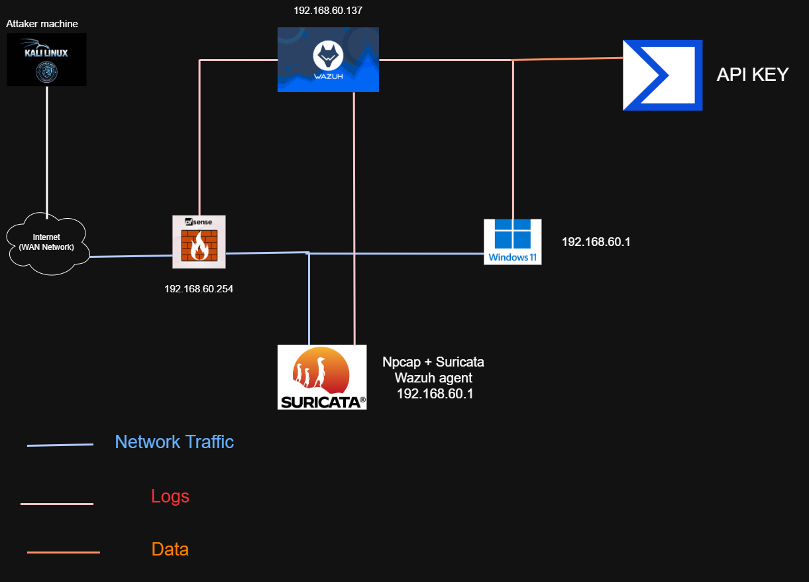

# 01 — Lab Architecture and Setup

> [!NOTE]
> This document describes how the lab is built and how every telemetry source reaches Wazuh. Detection logic is in [`03`](03-Detection-engineering.md); test results are in [`04`](04-threat-emulation-report.md). Configuration files referenced here live in `endpoints/`, `network/` and `siem-wazuh/`.

## 0. Summary

**Objective.** Build a small SOC lab with Wazuh (SIEM/XDR), Suricata (network IDS), pfSense (firewall/gateway) and Sysmon, then practise detection engineering: write custom decoders and rules, emulate attacks mapped to MITRE ATT&CK, and validate every rule against raw alert evidence.

**Scope.**
- pfSense `filterlog` decoder and rules, Suricata local rules, Sysmon / Windows Event Log rules, FIM and VirusTotal enrichment.
- A 12-stage attack chain (Reconnaissance → Exfiltration) run from Kali against the Windows endpoint.
- Correlation rules: brute force followed by a successful logon, LSASS access, log clearing.

**Status.** Most detections are confirmed by raw alerts; the per-stage result, the open gaps and the re-test plan are maintained in `docs/04` (§6 and §7) so this page does not repeat them. Suricata runs in **IDS mode only** (every rule is `alert`; nothing is dropped or blocked).

## 1. Architecture



| Component | Role | Network |
|---|---|---|
| **Wazuh server** (VM) | Manager, Indexer and Dashboard in one VM; receives agent data and pfSense syslog | NAT + host-only, `192.168.60.137` |
| **Windows 11 endpoint** | Victim. Runs the Wazuh agent, Sysmon, Suricata (Npcap) and FIM. Computer name `LAPTOP-VF92GC15`, agent name `window11Host` | VMnet1 (host-only), `192.168.60.1` |
| **Kali Linux** (VM) | Attacker | Host-only `192.168.60.135`; second adapter `192.168.254.100` on the pfSense WAN-side network, used only for the WAN-side test |
| **pfSense** (VM) | Firewall/gateway; forwards firewall logs to Wazuh by syslog | WAN (`em0`) `192.168.254.101/24`, gateway `192.168.254.1`; LAN (`em1`) `192.168.60.254/24` |

**Network facts used throughout the docs**
- Kali, pfSense (LAN), the Windows endpoint and the Wazuh server share one `/24`, `192.168.60.0/24`, on VMware VMnet1. Kali → Windows traffic is therefore **east-west on the same segment and does not cross pfSense**. pfSense only logs traffic that actually crosses it.
- pfSense DHCP serves `.100`–`.199`; Kali (`.135`) and Wazuh (`.137`) are inside that range, the Windows endpoint (`.1`) is outside it.
- Firewall rules in the committed backup: LAN "allow all", WAN "pass ICMP", a LAN ICMP-block test rule (disabled), automatic outbound NAT. **No inbound port-forward is configured**, so a WAN-side test exercises pfSense's default-deny logging, not forwarding to the endpoint.
- Early baseline captures (August 2026) show a LAN host at `192.168.60.101` (inside the DHCP range). All attack-chain tests use the endpoint at `192.168.60.1`; sample logs in `docs/03` that mention `.101` come from the baseline period.

### Versions

| Item | Version | Notes |
|---|---|---|
| Wazuh | 4.x (index pattern `wazuh-alerts-4.x-*`) | Record the exact build: `/var/ossec/bin/wazuh-control info`. Rule IDs of built-in rules referenced in `docs/03` (`60002`, `60106`, `92302`, `92657`…) depend on it |
| Suricata | 8.0.6 (from `suricata.yaml`) | Windows MSI, Npcap capture |
| Sysmon | schema 4.50, SwiftOnSecurity config v74 | Record the binary version from the `sysmon64.exe` banner |
| pfSense | Not recorded | backup file configuration (secure) |

Wazuh components, for reference: the **agent** collects and forwards data; the **manager** decodes events and applies rules; the **Indexer** (OpenSearch) stores alerts; the **Dashboard** (OpenSearch Dashboards) is the investigation UI. Installation guide: <https://documentation.wazuh.com/current/quickstart.html>.

## 2. VM resources

| VM | vCPU | RAM | Network |
|---|---:|---:|---|
| Wazuh server | 4 | 8 GB | NAT + host-only |
| pfSense | 2 | 2 GB | NAT (WAN) + host-only (LAN) |
| Kali Linux | 2 | 4 GB | Host-only + WAN-side adapter |

The Windows endpoint is attached to VMnet1 (see the note in §1).

## 3. pfSense

1. Create a VM (20 GB disk, 2 GB RAM, 2 vCPU). Adapter 1 → NAT (WAN, `em0`), adapter 2 → host-only (LAN, `em1`).
2. Assign `em0` = WAN `192.168.254.101/24` with gateway `192.168.254.1` (static in the committed backup) and `em1` = LAN `192.168.60.254/24`.
3. Open `https://192.168.60.254/` from a LAN host and sign in. **Change the default `admin` / `pfsense` password immediately.**
4. Remote logging: *Status → System Logs → Settings* → enable remote logging, server `192.168.60.137:514`, everything (config key `logall`), RFC 3164.
5. On the Wazuh manager add a syslog listener to `/var/ossec/etc/ossec.conf` and restart:

```xml
<remote>
  <connection>syslog</connection>
  <port>514</port>
  <protocol>udp</protocol>
  <allowed-ips>192.168.60.254</allowed-ips>
</remote>
```

```bash
sudo systemctl restart wazuh-manager
```

A second Suricata instance on pfSense is mentioned in `docs/03`, but no configuration or evidence from it is committed; everything validated in `docs/04` comes from the endpoint instance.

## 4. Suricata on the endpoint

1. Install the Windows MSI from <https://suricata.io/download/> (default path `C:\Program Files\Suricata\`) and Npcap with *WinPcap API-compatible mode*; check with `Get-Service npcap`.
2. Use the committed `network/Suricata_configuration/suricata.yaml` and `local.rules`. It already defines `HOME_NET`, enables `eve-log` to `eve.json` and loads the rule files; no further edit is needed. The `af-packet:` section is Linux-only and unused on Windows.
3. Start Suricata from an elevated PowerShell, passing the VMnet1 adapter on the command line (the GUID is machine-specific; list adapters with `Get-NetAdapter`):

```powershell
cd "C:\Program Files\Suricata\"
.\suricata.exe -c suricata.yaml -i "\Device\NPF_{B030E396-B937-4B1A-ADC6-B02699BCBC95}"
```

Output files in `C:\Program Files\Suricata\log\`: `eve.json`, `fast.log`, `stats.log`.

`HOME_NET` is `[192.168.60.0/24, !192.168.60.135]`: Kali is deliberately outside it so that inbound rules fire on Kali as an external source (explained in `docs/03` §2.1).

## 5. Windows endpoint

**Wazuh agent.** Install the MSI, enrol against `192.168.60.137`, then replace `C:\Program Files (x86)\ossec-agent\ossec.conf` with `endpoints/windows-11/ossec.conf` and restart (`Restart-Service -Name wazuh`). That file collects: `Security` (noisy event IDs excluded), `System`, `Application`, `Microsoft-Windows-OpenSSH/Operational`, `Microsoft-Windows-Sysmon/Operational`, the Suricata `eve.json`, and FIM on `C:\Users\LENOVO\Downloads\virustotaltest` and `C:\Users\LENOVO\tmp`. **The PowerShell Operational channel is configured for collection. However, the availability of module logging and script-block logging events must be verified separately.**

**Sysmon.** Install with the committed configuration (`endpoints/windows-11/sysmon_config.xml`, SwiftOnSecurity v74 plus a `ProcessAccess` filter on `lsass.exe`):

```powershell
sysmon64.exe -accepteula -i sysmon_config.xml    # first install
sysmon64.exe -c sysmon_config.xml                # update after editing
```

**Audit policy** (run elevated):

```powershell
auditpol /set /subcategory:"Logon" /success:enable /failure:enable
auditpol /set /subcategory:"Process Creation" /success:enable
reg add HKLM\Software\Microsoft\Windows\CurrentVersion\Policies\System\Audit /v ProcessCreationIncludeCmdLine_Enabled /t REG_DWORD /d 1 /f
```

## 6. Wazuh manager

1. Copy `siem-wazuh/custom-decoder/local_decoder.xml` to `/var/ossec/etc/decoders/` and the three files in `siem-wazuh/custom-rules/` to `/var/ossec/etc/rules/`.
2. Add the VirusTotal integration (block in `endpoints/manager/m_ossec.conf`, with your own API key; restrict it to `syscheck` alerts).
3. Validate and restart:

```bash
sudo /var/ossec/bin/wazuh-analysisd -t
sudo systemctl restart wazuh-manager
```

`endpoints/manager/m_ossec.conf` currently contains placeholders (`...`) for most sections; replace it with a sanitised copy of the real file so that the syslog listener and rule loading described above can be checked.

## 7. Validation

```powershell
ping 192.168.60.137          # from Windows
```
```bash
ping 192.168.60.254 && ping 192.168.60.137 && ping 192.168.60.1    # from Kali
```

```bash
sudo /var/ossec/bin/wazuh-analysisd -t
sudo /var/ossec/bin/wazuh-logtest
sudo tail -f /var/ossec/logs/alerts/alerts.json
```

1. First command check the **analysis engine configuration**
2. Checking the decoder / rule matching (valid or invalid)
3. Monitoring real alerts from attackers
| Flow | Path |
|---|---|
| Endpoint | Event Log / Sysmon → agent → manager → Indexer → Dashboard |
| Network IDS | Suricata → `eve.json` → agent → manager → Indexer → Dashboard |
| Firewall | pfSense → syslog UDP/514 → manager → Indexer → Dashboard |

The agent should show **Active** in *Agents management → Summary*.

**Exporting evidence.** Copy alerts from `/var/ossec/logs/alerts/alerts.json` on the manager (or the Dashboard's document view) and always record which one was used: the Dashboard and the Discover view escape backslashes differently, which matters when a rule matches Windows paths.
