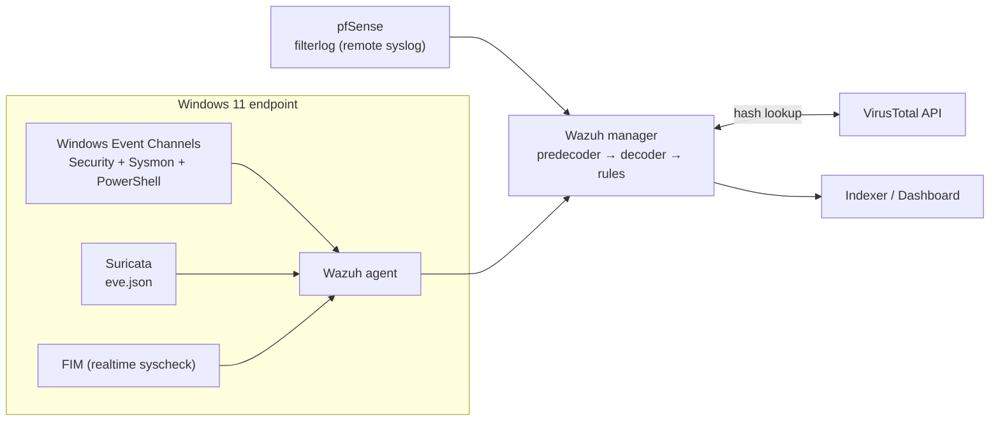

# 03 — Detection Engineering: Decoders & Rules

> Reference for every custom **decoder** and **rule** in the lab: **pfSense** (firewall), **Suricata** (network IDS) and **Sysmon / Windows Event Log** (endpoint).
> For each entry: *what it matches, why it is written that way, and where it can fail.*

**File origin**

| Type | File |
|---|---|
| Decoder (pfSense) | [`local_decoder.xml`](https://github.com/Khoavo-187/Wazuh-siem-home-lab/blob/main/siem-wazuh/custom-decoder/local_decoder.xml) |
| Wazuh rules (pfSense) | [`pfsense_rules.xml`](https://github.com/Khoavo-187/Wazuh-siem-home-lab/blob/main/siem-wazuh/custom-rules/pfsense_rules.xml) |
| Wazuh rules (Suricata wrappers) | [`suricata_rules.xml`](https://github.com/Khoavo-187/Wazuh-siem-home-lab/blob/main/siem-wazuh/custom-rules/suricata_rules.xml) |
| Wazuh rules (Sysmon & Windows events) | [`sysmon_rules.xml`](https://github.com/Khoavo-187/Wazuh-siem-home-lab/blob/main/siem-wazuh/custom-rules/sysmon_rules.xml) |
| Suricata rules | [`local.rules`](https://github.com/Khoavo-187/Wazuh-siem-home-lab/blob/main/network/Suricata_configuration/local.rules) |
| Suricata configuration | [`suricata.yaml`](https://github.com/Khoavo-187/Wazuh-siem-home-lab/blob/main/network/Suricata_configuration/suricata.yaml) |
| Sysmon configuration | [`sysmon_config.xml`](https://github.com/Khoavo-187/Wazuh-siem-home-lab/blob/main/endpoints/windows-11/sysmon_config.xml) (SwiftOnSecurity, source version 74) |
| Wazuh agent configuration | [`ossec.conf`](https://github.com/Khoavo-187/Wazuh-siem-home-lab/blob/main/endpoints/windows-11/ossec.conf) |

---

## 0. Overview

### 0.1 Data flow



| Source | Transport | Decoder | Parent rule |
|---|---|---|---|
| pfSense | Remote syslog to the manager (`192.168.60.137:514`, RFC 3164) | `pfsense-lab` + 5 child decoders (custom) | `100100` (custom) |
| Suricata (Windows endpoint) | `eve.json` → agent `localfile` (JSON) | Built-in JSON decoder | `86601` (built-in Suricata alert rule) |
| Sysmon / Security / PowerShell | Event Channel → agent | `windows_eventchannel` (built-in) | Built-in Sysmon / Windows rules (`sysmon_event*` groups, `60002`, `60106`, `60122`, `92302`, `92651`, `92657`, `63103`) |

### 0.2 ID ranges

| Wazuh rule IDs | Source | Content |
|---|---|---|
| `100100`–`100140` | pfSense | Base, block/pass, scan and TCP burst |
| `100200`–`100201` | pfSense | ICMP and ping-sweep correlation |
| `100300`–`100310` | Suricata | Wrappers for SIDs `1000002`–`1000012`; `100310` / SID `1000012` is Stage 11 and pending validation |
| `100400`–`100416` | Sysmon / Windows Security / PowerShell | Process, network, file, registry, authentication, credential access and anti-forensics |
| `1000002`–`1000012` | Suricata SIDs (not Wazuh IDs) | Endpoint network signatures in `network/Suricata_configuration/local.rules` |

### 0.3 Rule attributes used in this document

| Attribute | Meaning |
|---|---|
| `if_sid` / `if_group` | Child rule: evaluated only when the parent rule (or any rule of the group) matched **on the same event** |
| `if_matched_sid` + `frequency` / `timeframe` | Correlation: fires when the target rule matched ≥ N times within T seconds |
| `same_source_ip`, `same_field`, `different_*` | Events in a correlation chain must share (or differ in) the given field |
| `ignore` | After firing, mute the rule for N seconds |
| `options no_log` | Match for chaining/correlation only; no alert is generated |
| *Evaluation order* | One event produces **at most one alert**. Wazuh walks the rule tree, takes the first matching sibling (load order: built-in rules before custom ones, then file order) and then evaluates that rule's children; the deepest match is the one reported. A parent therefore never "also fires" — it is only a precondition. Put specific rules before generic ones, or chain them with `if_sid` |

> `frequency` thresholds follow Wazuh's counting and can be off by ±1 event from the figures quoted below.

---

## 1. pfSense

### 1.1 `filterlog` format

pfSense forwards firewall logs to the manager over syslog (remote logging set to *everything*, `logall` in pfSense's `config.xml`; RFC 3164). The syslog header is not consistent: in some events the hostname is missing and Wazuh's predecoder puts `filterlog[pid]:` into the `hostname` field. That is why the parent decoder matches on the **message content** and not on `program_name`.

Sample line (IPv4 TCP):

```text
Aug  8 10:53:29 filterlog[63489]: 80,,,100000101,em1,match,pass,in,4,0x0,,128,33199,0,DF,6,tcp,52,192.168.60.101,162.159.197.3,61197,443,0,S,1576499639,,65535,,mss;nop;wscale;nop;nop;sackOK
```

| # | filterlog field | Example | Wazuh field |
|---|---|---|---|
| 1 | rule number | `80` | `pfsense.rulenum` |
| 2 | sub-rule | *(empty)* | skipped (the `,,,` in the regex) |
| 3 | anchor | *(empty)* | skipped |
| 4 | tracker | `100000101` | `pfsense.tracker` |
| 5 | interface | `em1` | `pfsense.interface` |
| 6 | reason | `match` | `pfsense.reason` |
| 7 | action | `pass` | **`action`** (static) |
| 8 | direction | `in` | `pfsense.direction` |
| 9 | IP version | `4` | `pfsense.ipversion` |
| 10 | TOS | `0x0` | `pfsense.tos` |
| 11 | ECN | *(empty)* | `pfsense.ecn` |
| 12 | TTL | `128` | `pfsense.ttl` |
| 13 | IP ID | `33199` | `pfsense.id` |
| 14 | fragment offset | `0` | `pfsense.offset` |
| 15 | IP flags | `DF` | `pfsense.flags` |
| 17 | protocol text | `tcp` | **`protocol`** (static) |
| 18 | length | `52` | `pfsense.length` |
| 19 | source IP | `192.168.60.101` | **`srcip`** (static) |
| 20 | destination IP | `162.159.197.3` | **`dstip`** (static) |
| 21 | source port | `61197` | **`srcport`** (static) |
| 22 | destination port | `443` | **`dstport`** (static) |
| 23 | data length | `0` | `pfsense.data_length` |
| 24+ | TCP flags, seq, ack, window, options | `S,1576499639,…` | **not decoded** |

Bold fields are Wazuh *static fields*: rules can use them directly (`<action>`, `<protocol>`, `<same_source_ip/>`, `$(srcip)`). All other fields live under `data.pfsense.*`.

Interfaces seen in the lab logs: `em1` (LAN `192.168.60.0/24`), `em0` (WAN side `192.168.254.0/24`), `lo0` (loopback).

### 1.2 Decoder tree

```text
pfsense-lab                      (parent: recognises every filterlog line)
├── pfsense-lab-ports            IPv4 TCP / UDP
├── pfsense-lab-icmp             IPv4 ICMP
├── pfsense-lab-igmp             IPv4 IGMP
├── pfsense-lab-ipv4             IPv4, any other protocol (fallback)
└── pfsense-lab-ipv6             IPv6
```

| Decoder | Prematch (short) | Extra fields (beyond the common prefix) |
|---|---|---|
| `pfsense-lab` | `filterlog\[\d+\]:\s*` | none (parent only) |
| `pfsense-lab-ports` | IPv4 + `tcp` or `udp` | `srcport`, `dstport`, `pfsense.data_length` |
| `pfsense-lab-icmp` | IPv4 + `icmp` | `pfsense.icmp_type`, `pfsense.icmp_id`, `pfsense.icmp_seq` |
| `pfsense-lab-igmp` | IPv4 + `igmp` | none (stops at `dstip`) |
| `pfsense-lab-ipv4` | IPv4, protocol ∉ {tcp, udp, icmp, igmp} | none (stops at `dstip`) |
| `pfsense-lab-ipv6` | IPv6 (`,6,`) | `pfsense.class`, `pfsense.flowlabel`, `pfsense.hoplimit` |

#### `pfsense-lab` — parent
- PCRE2 prematch `filterlog\[\d+\]:\s*` finds `filterlog[<pid>]:` anywhere in the line.
- Children use `offset="after_parent"`: their regex starts **after** `filterlog[pid]: `, so the (variable) syslog header never needs to be parsed.

#### `pfsense-lab-ports` — IPv4 TCP / UDP
- Prematch: `\d+,,,.*?,4,.*?,(?:tcp|udp),` — rule number followed by `,,,` (empty sub-rule and anchor), version `4`, protocol `tcp` or `udp`.
- The regex has 21 capture groups mapped one-to-one to the 21 names in `<order>`.
- The `(tcp|udp)` group fills the static field `protocol`, which lets rule `100140` filter on `^tcp$`.
- UDP example: `76,,,1000002661,em0,match,pass,out,4,0x0,,63,4250,0,none,17,udp,64,192.168.254.101,8.8.8.8,20455,53,44` → `srcip=192.168.254.101`, `dstip=8.8.8.8`, `dstport=53`, `pfsense.data_length=44`.

#### `pfsense-lab-icmp` — IPv4 ICMP
- After `dstip`, an ICMP echo carries three fields: type (`request` / `reply`), id, sequence.
- Example: `74,,,1000002565,em1,match,pass,out,4,0x0,,64,40058,0,none,1,icmp,84,192.168.60.254,192.168.60.101,request,40169,064` → `pfsense.icmp_type=request`, `pfsense.icmp_id=40169`, `pfsense.icmp_seq=064`.

#### `pfsense-lab-igmp` — IPv4 IGMP
- Extracts up to `dstip` and ignores the options that follow. Purpose: multicast traffic (`224.0.0.x`) is decoded instead of falling through to the generic fallback.

#### `pfsense-lab-ipv4` — IPv4 fallback
- Catches every remaining IPv4 protocol (ESP, GRE, OSPF, …).
- The protocol group uses a negative lookahead `((?!(?:tcp|udp|icmp|igmp),)[^,]+)` to **exclude** the four protocols that already have a dedicated decoder, so the child decoders never overlap.

#### `pfsense-lab-ipv6` — IPv6
- Differences from IPv4: after the version come `class`, `flowlabel`, `hoplimit`, and the **protocol text comes before the protocol ID** (reverse of IPv4). The regex mirrors that with `([^,]+),(\d+)`.
- Extracts up to `srcip` / `dstip`; no ports.

#### Decoder limitations

| # | Limitation | Consequence |
|---|---|---|
| 1 | TCP flags (`S`, `SA`, `F`, …) are not extracted | SYN cannot be told apart from other packets; `100140` counts logged `pass` events rather than SYNs |
| 2 | The ICMP decoder only matches echo (`type,id,seq`) | Other ICMP types (unreachable, time-exceeded, …) use a different layout and would need their own decoder to get `srcip`/`dstip` — *confirm with `wazuh-logtest`* |
| 3 | `sub-rule` and `anchor` must be empty (`,,,`) | Events from rules inside an anchor are not decoded |
| 4 | No ports for IPv6 | IPv6 port scans are invisible |
| 5 | Loose prematch (`.*?,4,` can match by accident) | Harmless, because the regex that follows pins every position; anchoring with `^` would be a cheap optimisation |

### 1.3 pfSense rules

```text
filterlog ─► 100100 (base, no_log)
              ├─► 100101 block ──► 100102  ≥10 blocks / 60s, same source
              ├─► 100110 pass  ──► 100140  ≥15 connections / 10s, same src → dst:port (TCP)
              ├─► 100200 ICMP  ──► 100201  ≥8 ICMP / 30s, same source, many destinations
              └─► 100130  ≥15 events / 30s, same source, many different dst ports (any action)
```

| ID | Level | Condition | Correlation | MITRE |
|---|---|---|---|---|
| `100100` | 1 (`no_log`) | `decoded_as pfsense-lab` | none | none |
| `100101` | 5 | `action = block` | none | none |
| `100102` | 10 | rule `100101` | ≥10 / 60s, `same_source_ip`, `ignore 120` | T1046 |
| `100110` | 3 (`no_log`) | `action = pass` | none | none |
| `100130` | 10 | any `100100` event | ≥15 / 30s, `same_source_ip`, `different_dstport`, `ignore 120` | T1046 |
| `100140` | 6 | rule `100110` + `protocol = tcp` + `dstport` in `{22,23,445,3389,5900,1433,3306}` | ≥15 / 10s, same src, dst, dstport, `ignore 60` | none |
| `100200` | 3 (`no_log`) | `protocol = icmp` | none | none |
| `100201` | 8 | rule `100200` | ≥8 / 30s, `same_source_ip`, `different_dstip`, `ignore 120` | T1018 |

#### `100100` — Firewall log detected (level 1, `no_log`)
Root of the whole pfSense tree. `no_log` keeps thousands of level-1 alerts out of the index, while the rule still serves as the parent for the `if_sid` / `if_matched_sid` rules below.

#### `100101` — Traffic blocked (level 5)
- `if_sid 100100` + `<action>block</action>` (`action` is the static field from column 7 of filterlog).
- One alert per blocked packet; the description carries the 5-tuple `$(srcip):$(srcport) -> $(dstip):$(dstport)`.
- Limitation: only `block` is matched; `reject` (pfSense answers with RST/ICMP) is not covered.

#### `100102` — Multiple firewall blocks (level 10)
- Correlation on `100101`: ≥10 packets blocked from the same `srcip` within 60s → scan or brute force against closed ports. Mapped to T1046.
- `ignore 120` mutes the rule for 120s after it fires.

#### `100110` — Traffic allowed (level 3, `no_log`)
Not meant to alert. It is the link that lets `100140` count allowed connections.

#### `100130` — Possible port scan, many destination ports (level 10)
- Correlation over **all** pfSense events (`100100`, pass and block): same `srcip`, ≥15 different `dstport` values within 30s. Mapped to T1046.
- Detects scans by **behaviour** (diversity of destination ports) instead of by action, so it still fires when ports are open and traffic is passed (where `100102` sees nothing).
- Limitation: an internal host legitimately reaching many services at once can cross the threshold.
- Lab trigger: `nmap -sS -p1-1000 <target>` from Kali.

#### `100200` — ICMP ping detected (level 3, `no_log`)
- `if_sid 100100` + `<protocol>^icmp$</protocol>`.
- Purpose: record pings and feed `100201`. Fixed to level 3 + `no_log` (was level 7, alerting on every ICMP packet including pfSense's own gateway monitoring) — only `100201` (the correlation) now alerts.

#### `100201` — Ping sweep (level 8)
- Correlation on `100200`: same `srcip`, ≥8 different `dstip` within 30s. Mapped to T1018 (Remote System Discovery).
- Lab trigger: `nmap -sn 192.168.60.0/24`.

#### `100140` — TCP connection burst (level 6)
- Correlation on `100110`: same `srcip`, `dstip`, `dstport`, `protocol = tcp`, `dstport` restricted to administrative services (`22` SSH, `23` Telnet, `445` SMB, `3389` RDP, `5900` VNC, `1433` MSSQL, `3306` MySQL), ≥15 events within 10s.
- Meaning: flood or brute force against **one** admin service. pfSense is stateful and logs only the packet that creates the state, so the number of `pass` events approximates the number of new connections.
- "SYN burst" is only approximate, because TCP flags are not decoded (limitation #1).
- Fixed: originally matched *any* destination port, which made ordinary HTTPS bursts to a single CDN endpoint (e.g. a browser opening many parallel connections to one server on port 443) cross the threshold. Restricting `dstport` to the admin-service list above removed that false positive; re-check this list if new internal services are added.

---

## 2. Suricata

### 2.1 Sensor and configuration

The rules and configuration published in this repo belong to the Suricata instance running on the **Windows 11 endpoint** (`default-rule-path: C:\Program Files\Suricata\rules\`). The second instance on the pfSense WAN interface is not part of the repo.

Settings in [`suricata.yaml`](https://github.com/Khoavo-187/Wazuh-siem-home-lab/blob/main/network/Suricata_configuration/suricata.yaml) that shape every rule below:

| Setting | Value | Effect |
|---|---|---|
| `HOME_NET` | `[192.168.60.0/24, !192.168.60.135]` | The whole LAN **except Kali** (`.135`) |
| `EXTERNAL_NET` | `!$HOME_NET` | In practice: Kali plus the Internet |
| `rule-files` | `local.rules` (`emerging-all-fixed.rules` is commented out since 2026-11-01) | Alerts from other rule sets are not wrapped by the custom rules; preserved evidence currently covers SIDs `1000002`–`1000011`; SID `1000012` remains pending validation |
| `eve-log` | enabled (`alert`, `http`, `dns`, `tls`, `files`, …) → `eve.json` | `eve.json` is the file the Wazuh agent tails |

Why `HOME_NET` excludes Kali: with Kali inside `$HOME_NET`, rules written as `$HOME_NET → any` (reverse shell ports) fired on Nmap scans run **from** the attacker. Removing the attacker from `$HOME_NET` makes it an `$EXTERNAL_NET` source, so the inbound rules (`1000002`, `1000003`) fire on Kali and the outbound rules no longer fire on Kali's own traffic.

### 2.2 Rule inventory

| SID | Detection | Match | Wazuh rule | Level | MITRE |
|---|---|---|---|---:|---|
| `1000002` | Port scan | SYNs from `$EXTERNAL_NET` to `$HOME_NET`, ≥15 in 10s per source | `100300` | 5 | T1595 |
| `1000003` | SSH attempts | SYNs to port 22, ≥5 in 60s per source | `100301` | 8 | T1110 |
| `1000004` | RDP attempt | SYNs to port 3389, ≥5 in 60s per source | `100302` | 6 | T1133 |
| `1000005` | SMB probe | SYNs to port 445, ≥5 in 60s per source | `100303` | 6 | T1046 |
| `1000006` | Reverse-shell ports | Established outbound traffic to `4444, 1337, 31337, 5555`; thresholded by destination | `100304` | 12 | T1071 |
| `1000007` | curl User-Agent | HTTP request whose User-Agent contains `curl` | `100305` | 5 | T1592 (heuristic lab mapping) |
| `1000008` | EICAR download | HTTP response body contains the EICAR prefix | `100306` | 10 | T1105 |
| `1000009` | DNS test domain | DNS query for `malware-test.local` | `100307` | 9 | T1071.004 |
| `1000010` | Windows CMD banner | Outbound payload contains the `cmd.exe` banner | `100308` | 12 | T1071 |
| `1000011` | curl script/binary download | `curl` User-Agent plus URI ending in a configured script/binary extension | `100309` | 8 | T1105 |
| `1000012` | Stage 11 HTTP POST | HTTP POST to `/upload` from `$HOME_NET` to `$EXTERNAL_NET` on destination port `4445` | `100310` | 8 | T1048.003 (intended mapping; transfer not yet verified) |

The SID `1000012` and wrapper `100310` are implemented but have no preserved positive alert. Do not include them in a list of validated detections until a controlled POST test produces the raw Suricata EVE event and Wazuh alert.

### 2.3 Anatomy of a rule (sid 1000002)

```text
alert tcp $EXTERNAL_NET any -> $HOME_NET any (
  msg:"LOCAL Possible Port Scan - Multiple SYN in short time";
  flow:to_server; flags:S;
  threshold:type both, track by_src, count 15, seconds 10;
  classtype:attempted-recon;
  metadata:mitre_tactic_id TA0043, mitre_technique_id T1595;
  sid:1000002; rev:3;)
```

| Part | Meaning |
|---|---|
| `alert tcp $EXTERNAL_NET any -> $HOME_NET any` | Action, protocol, source (address, port) → destination (address, port) |
| `flow:to_server` | Client-to-server direction only |
| `flags:S` | Exactly SYN — excludes SYN-ACK, so only connection **initiations** count |
| `threshold:type both, track by_src, count 15, seconds 10` | Alert once when a source reaches 15 matches within 10s, then stay quiet until the window ends |
| `classtype` | Category used for Suricata's priority and reporting |
| `metadata` | MITRE tags, carried into `eve.json` under `alert.metadata` |
| `sid` / `rev` | Rule identifier (local range ≥ 1,000,000) and revision |

### 2.4 Rule by rule

#### `1000002` — Possible port scan
Counts SYN-only packets: ≥15 from one source within 10s. Depends on `$EXTERNAL_NET` — only Kali (or the Internet) can trigger it. Trigger: `nmap -sS <target>` from Kali.

#### `1000003` — Repeated SSH connection attempts
Same idea, destination port 22, lower threshold (5 per 60s). It counts **connection attempts**, not failed logins, so it fits brute-force tooling such as Hydra. Mapped to T1110.

#### `1000004` — RDP connection attempt
Source is `any`, so internal hosts are covered too. Counts SYNs to 3389 (≥5 per 60s). Mapped to T1133 (External Remote Services).

#### `1000005` — SMB port probe
Same pattern on port 445. The committed `local.rules` maps T1046 to **Discovery (TA0007)**; this corrects an earlier `TA0043` mapping.

#### `1000006` — Possible reverse shell, suspicious outbound port
- Source `$HOME_NET` → any, ports `4444` (Metasploit default), `1337`, `31337`, `5555`.
- Revision 3 replaced `flags:S` with `flow:to_server,established`, so only connections that completed the handshake match. This removed the false positives caused by Nmap SYN scans (a half-open probe never reaches `established`).
- The committed rule already contains `threshold:type limit, track by_dst, count 1, seconds 60` to reduce repeated alerts per destination within a 60-second window (not necessarily one alert per individual flow).
- Port lists are easy to evade (see the README's *Detection Philosophy*); `1000010` complements it.

#### `1000007` — Recon tool user-agent (curl)
Matches `curl` in the HTTP User-Agent for any source and destination. Low fidelity: `curl` is also a legitimate admin and developer tool, so treat the alert as context, not a verdict.

#### `1000008` — EICAR test file over HTTP
`file_data` inspects the HTTP response body; the content match `X5O!P%@AP[4` is the beginning of the standard EICAR string. Direction `to_client` towards `$HOME_NET` means a host in the lab **downloaded** the file. HTTP only: HTTPS bodies are not visible.

#### `1000009` — DNS query to suspicious test domain
`dns.query` buffer, `nocase` match on `malware-test.local`. It is a lab marker for the C2-over-DNS pattern (T1071.004), not a real indicator. It sees only DNS that crosses the sensor.

#### `1000010` — Reverse shell banner (Windows)
- Behavioural rule: matches the banner a Windows `cmd.exe` prints when a shell starts (`Microsoft Windows [Version …]` followed within 100 bytes by `(c) Microsoft Corporation`), sent **outbound** on an established connection, on **any port** (so it still works when the shell uses 80 or 443).
- Limits: plain-text traffic only; matches the `cmd.exe` banner, not the PowerShell one (`Windows PowerShell` / `Copyright (C)`), even though the message says "CMD/Powershell"; a reverse shell that prints no banner is not seen.

#### `1000011` — Suspicious download via curl
`curl` user-agent plus a URI ending in `.sh`, `.ps1`, `.exe`, `.bat` or `.dll`, from `$HOME_NET` to `$EXTERNAL_NET` (in the lab: the endpoint pulling a payload from Kali). The `$` anchor means a trailing query string (`?x=1`) defeats the match. It overlaps with `1000007`, so one request can raise both alerts.

### 2.5 Wazuh wrapper rules

Every wrapper has the same shape:

```xml
<rule id="100300" level="5">
  <if_sid>86601</if_sid>
  <field name="alert.signature_id">1000002</field>
  <description>Suricata: Possible Port Scan from $(src_ip)</description>
  <mitre><id>T1595</id></mitre>
  <group>recon,network_scan</group>
</rule>
```

- `86601` is Wazuh's built-in parent for Suricata `alert` events; the wrapper narrows it to a single `alert.signature_id`.
- `$(src_ip)` and `$(dest_port)` come from the JSON fields of `eve.json`.
- Level and MITRE ID are assigned here (not in Suricata), so severity can be tuned without touching the sensor.
- The `field` value is a pattern match, not an equality test. Anchor it (`^1000002$`) so a future sid such as `10000021` cannot match by accident.

#### `100308` / `100309` — wrappers for sids `1000010` and `1000011`
Added after the initial baseline review (both sids originally had no Wazuh wrapper, so their alerts were unclassified and unscored):

```xml
<rule id="100308" level="12">
  <if_sid>86601</if_sid>
  <field name="alert.signature_id">1000010</field>
  <description>Suricata: Windows shell banner sent outbound - possible reverse shell from $(src_ip) to $(dest_ip):$(dest_port)</description>
  <mitre><id>T1071</id></mitre>
  <group>command_and_control,reverse_shell</group>
</rule>

<rule id="100309" level="8">
  <if_sid>86601</if_sid>
  <field name="alert.signature_id">1000011</field>
  <description>Suricata: curl download of script or executable from $(src_ip)</description>
  <mitre><id>T1105</id></mitre>
  <group>command_and_control,download_execution</group>
</rule>
```

Same shape as the other eight wrappers; `100308` maps the banner rule (T1071, level 12 — a reverse shell banner is a strong signal), `100309` maps the curl-download rule (T1105, level 8).

#### `100310` — Stage 11 HTTP POST wrapper (SID `1000012`)

The wrapper maps the local Suricata Stage 11 HTTP POST signature to a Wazuh alert. The current XML requires built-in parent `86601` and an exact `alert.signature_id` match for `1000012`.

```xml
<rule id="100310" level="8">
  <if_sid>86601</if_sid>
  <field name="alert.signature_id">^1000012$</field>
  <description>
    Suricata: HTTP POST upload request to Stage 11 receiver
    from $(src_ip) to $(dest_ip):$(dest_port)
  </description>
  <mitre>
    <id>T1048.003</id>
  </mitre>
  <group>exfiltration,http,</group>
</rule>
```

This is a detection of the configured HTTP POST pattern, not proof that the ZIP body was received in full. The SID and wrapper are **pending validation**.
---

## 3. Sysmon & Windows Security events

### 3.1 Telemetry requirements

A Wazuh rule can only fire if the event exists. The Sysmon configuration is [`sysmon_config.xml`](https://github.com/Khoavo-187/Wazuh-siem-home-lab/blob/main/endpoints/windows-11/sysmon_config.xml) (SwiftOnSecurity, source version 74, Sysmon 13+). The agent is configured to collect the `Microsoft-Windows-Sysmon/Operational`, `Microsoft-Windows-PowerShell/Operational`, `Security`, `System` and `Application` channels (see [`ossec.conf`](https://github.com/Khoavo-187/Wazuh-siem-home-lab/blob/main/endpoints/windows-11/ossec.conf)).

| Event | Used by | What `sysmon_config.xml` does | Effect on the rules |
|---|---|---|---|
| **1** ProcessCreate | `100400`–`100403`, `100407` | `onmatch="exclude"`: everything is logged except the listed noise | Covered |
| **3** NetworkConnect | `100404`, `100414` | Include list: specific images (`powershell.exe`, `cmd.exe`, `certutil.exe`, `bitsadmin.exe`, `nc.exe`, …), any binary under `C:\Users`, `C:\ProgramData`, `C:\Windows\Temp`, and a port list (22, 3389, 4444, 5900, …). Excludes Defender, Teams, `*.microsoft.com`, loopback | `100404` and `100414` are covered because PowerShell / cmd / certutil are included. `100413` does not use this Sysmon event; it relies on PowerShell Module Logging (4103) |
| **10** ProcessAccess | `100411`, `100416` | `include` filter on `\lsass.exe` (fixed — was empty) | Covered, and now confirmed live by a false-positive test (see §3.3, `100411`) |
| **11** FileCreate | `100405` | Include by extension and folder (`.exe`, `.dll`, `.ps1`, `.bat`, `\Downloads\`, `\Startup\`, …); no generic `\Temp\` or `\AppData\Roaming\` filter | The rule only sees files already selected by extension/folder, so in practice it flags **executables and scripts** written to Temp or Roaming |
| **13** RegistryEvent | `100406` | Includes `CurrentVersion\Run` (covers `Run`, `RunOnce`, …) | Covered |
| Security **4625 / 4624 / 1102** | `100408`, `100410`, `100412` | Not Sysmon — Windows Security log | Needs the `Security` channel (configured) and the matching audit policy |
| PowerShell **4103** (Module Logging) | `100413` | Windows PowerShell policy; not controlled by Sysmon | Operational channel configured in the agent; Module Logging and alert generation **not yet verified** |
| PowerShell **4104** (Script Block Logging) | Future PowerShell-content detections | Windows PowerShell policy; independent of Sysmon | Channel configured; Script Block Logging and ingestion **not yet verified** |

> SwiftOnSecurity's `name=` tags use the legacy technique IDs of 2021 (for example `T1060`, today `T1547.001`). Use the MITRE IDs from the Wazuh rules, not those tags.

### 3.2 Field names

Wazuh's `windows_eventchannel` decoder exposes Sysmon and Security data under `win.eventdata.*` and `win.system.*` with a lower-case first letter: `parentImage`, `image`, `commandLine`, `user`, `targetFilename`, `targetObject`, `destinationIp`, `destinationPort`, `sourceImage`, `targetImage`, `ipAddress`, and `win.system.eventID`.

The rules chain on built-in groups whose names are not consistent (`sysmon_event1`, `sysmon_event3`, but `sysmon_event_10`, `sysmon_event_11`, `sysmon_event_13`). Verify them against your Wazuh version (see §6).

### 3.3 Rules

| ID | Level | Trigger | Correlation / parent | MITRE | Current evidence status |
|---|---:|---|---|---|---|
| `100400` | 5 | EID 1; parent process is PowerShell, pwsh, cmd or net; excludes discovery/LOLBin child images listed in XML | None | — | Historical raw alert exists; current exclusions need regression test |
| `100401` | 13 | EID 1; `originalFileName` is `powershell.exe`; command line contains encoded-command switch and a long argument | None; independent of `100400` | T1027, T1059.001 | Historical alert is level 10; current level-13 revision needs retest |
| `100402` | 6 | EID 1; image is whoami, systeminfo, tasklist, nltest, net/net1 or arp | None | T1033, T1082, T1087 | Current ARP/net/net1 interaction with `100400` needs regression test |
| `100403` | 8 | EID 1; image is certutil or bitsadmin | None | T1105 | Implemented; individual positive evidence not indexed |
| `100404` | 7 | EID 3; image is PowerShell or cmd | None | T1071 (investigative signal) | Implemented; no Stage 11 EID 3 evidence |
| `100405` | 7 | EID 11; path contains `\\Temp\\` or `\\AppData\\Roaming\\` | None | T1105 | Implemented; Temp ZIP path configured; positive evidence pending |
| `100406` | 10 | EID 13; `targetObject` ends in a Run/RunOnce key | Built-in `92300` OR `92302` | T1547.001 | Historical custom alert exists; `92302` path documented; `92300` alternative not separately tested |
| `100407` | 12 | Discovery events matched by `100402` | ≥3 / 120s, same user | T1087 | Historical positive correlation exists; retest current `100400`/`100402` interaction |
| `100408` | 10 | Event 4625 matched by built-in `60122`; source IP is not `-` | ≥5 / 60s, same `ipAddress`, ignore 120s | T1110 | Custom alert confirmed 2026-10-10 |
| `100410` | 13 | Event 4624, current event matches built-in `92651` OR `92657` | Six prior `60122` matches / 200s, same source IP | T1110, T1078 | Current correlation pending validation |
| `100411` | 14 | EID 10 targeting LSASS; source-image allow-list exclusion and configured memory-read access masks | None | T1003.001 | Telemetry observed; true-positive detection pending |
| `100412` | 15 | Security Event 1102 | Built-in parent `63103` | T1070.001 | Historical custom alert predates current parent; current revision pending |
| `100413` | 9 | PowerShell Operational Event 4103; payload contains Invoke-WebRequest | Built-in parent `91801` | T1059.001 | Module Logging and positive match pending |
| `100414` | 12 | EID 3; PowerShell or certutil connects to port 80/443 | None | T1105; T1041 only as an investigation hypothesis if the actual channel is C2 | Implemented; no positive evidence indexed |
| `100415` | 12 | Child of `100403`; command line contains selected download/decode arguments | `if_sid 100403` | T1105 | Implemented; argument matching needs positive/negative test |
| `100416` | 15 | LSASS access call trace contains dbghelp/dbgcore or UNKNOWN | Child of `100411` | T1003.001 | No positive evidence |

#### `100400` — Shell spawned child process (level 5)

The rule uses `if_group sysmon_event1` and matches `win.eventdata.parentImage` ending in `powershell.exe`, `pwsh.exe`, `cmd.exe` or `net.exe`. It is a broad process-lineage signal: the description records parent image, child image, command line and user.

The current negated child-image pattern excludes `whoami`, `systeminfo`, `tasklist`, `nltest`, `net`/`net1`, `arp`, `bitsadmin` and `certutil`. The purpose is to let the more specific `100402` discovery rule and `100403` LOLBin rule match instead of allowing this generic shell-child rule to take precedence. The XML does **not** currently exclude `curl`.

A historical raw alert shows `100400` matching `ARP.EXE` on 2026-10-13. The current XML now excludes ARP from `100400` and includes it in `100402`; therefore that historical alert does not validate the current ARP routing. Re-test `arp.exe`, `net.exe` and `net1.exe` with `wazuh-logtest` and a fresh endpoint event.

#### `100401` — Encoded PowerShell command (current XML level 13)

The current rule is independent of `100400` and matches Sysmon EID 1 using `win.eventdata.originalFileName` (not `win.eventdata.image`) equal to `powershell.exe`, plus an encoded-command switch and a non-space argument of at least 20 characters.

Current matching fields:

```xml
<field name="win.eventdata.originalFileName" type="pcre2">(?i)^powershell\.exe$</field>
<field name="win.eventdata.commandLine" type="pcre2">(?i)(?:^|\s)[-/](?:e|ec|en[a-z]*)\s+\S{20,}</field>
```

The committed XML is level **13**. The preserved Stage 4 JSON alert is historical level **10**. The event demonstrates that an earlier rule revision matched the encoded PowerShell test; it does not demonstrate that the current level-13 definition has been retested. Keep that distinction in README and the evidence index.

#### `100402` — Reconnaissance binary (level 6)

The current EID 1 image pattern includes `whoami.exe`, `systeminfo.exe`, `tasklist.exe`, `nltest.exe`, `net.exe`, `net1.exe` and `arp.exe`. These tools are individually common administrative utilities, so the rule is a lower-severity base signal; `100407` raises the significance when multiple discovery binaries execute under the same user within the configured window.

The current XML includes ARP. The October 13 archived `stage05-rule-100400-shell-child-arp.json` shows the older behavior where `ARP.EXE` matched `100400`; it is not evidence for the current `100402` ARP condition. The archived `100407` correlation demonstrates a historical discovery burst, but the latest `100400` exclusion list and `100402` image pattern must be tested together to confirm current rule precedence.
#### `100403` — LOLBin download/decode (level 8)
EID 1 for `certutil.exe` or `bitsadmin.exe`, both able to fetch or decode files (T1105). The rule does not inspect arguments, so legitimate certificate operations also match — kept deliberately low-fidelity as a base signal; `100415` below adds the high-fidelity child.

#### `100415` — LOLBin with download/decode arguments (level 12)
Child of `100403` (`if_sid 100403`). Narrows to command lines containing `urlcache`, `verifyctl`, `decode`/`decodehex`, `transfer`, `addfile` or `setnotifycmdline` — the switches `certutil`/`bitsadmin` actually use to fetch or persist a payload (T1105; see the dedicated walkthrough of how each switch is abused, covered earlier in this project). Still argument-only: it does not check the URL or output path, so a legitimate `-decode` in an install script can still match.

#### `100404` — Outbound connection from PowerShell / cmd (level 7)
EID 3 where the image is `powershell.exe` or `cmd.exe`. Shells rarely need direct network access, so any connection is worth a look (T1071). `sysmon_config.xml` includes these images, so the event is available for any destination port.

#### `100405` — File created in a sensitive path (level 7)
EID 11 with `targetFilename` containing `\Temp\` or `\AppData\Roaming\`. As explained in §3.1, Sysmon only logs executable/script extensions and a few folders, so the effective detection is *"executable or script dropped into Temp/Roaming"* (T1105).

#### `100406` — Registry Run key persistence (level 10)

The rule matches `win.eventdata.targetObject` paths ending in `CurrentVersion\\Run` or `CurrentVersion\\RunOnce`, covering HKCU/HKLM paths represented in Sysmon EID 13.

The current XML uses:

```xml
<if_sid>92300,92302</if_sid>
```

The comma-separated IDs are alternative parent candidates (OR): the custom rule may be evaluated under whichever built-in rule matches the event. The October 13, 2026 raw `100406` re-test is documented as the `92302` / `reg.exe` path. The additional `92300` parent is present in the current XML but is not independently demonstrated by the saved evidence.

The original design used `if_group sysmon_event_13`, which competed with the built-in Run-key rule and did not produce the custom alert. Chaining the custom rule under a built-in event-specific parent solved the historical `92302` path. Do not claim that the `92300` alternative is validated until a representative event matching that parent is replayed or captured.

#### `100407` — Multiple reconnaissance commands (level 12)
Correlation on `100402`: ≥3 recon binaries from the same `win.eventdata.user` within 120s. A single `whoami` is routine; a burst of discovery commands is **active enumeration** (T1087). It depends on `100402` actually being the rule that fires for those events (see precedence note, §5 item 2).

#### `100408` — Failed logon burst (level 10)
Correlation on rule `60122` (failed logon, event 4625): ≥5 failures from the same `ipAddress` within 60s. Entries with `ipAddress` equal to `-` (local logons without a source address) are excluded by a negated field match. Mapped to T1110. It fits network logons (RDP, SMB, OpenSSH for Windows).

#### `100410` — Successful Authentication After Repeated Failed Logons (Level 13)

**Detection objective:** Detect a successful Windows remote-logon event associated with repeated failed-logon activity from the same source IP address.

**Current committed configuration — correlation validation pending**

```xml
<rule id="100410" level="13" frequency="6" timeframe="200">
  <!-- Parent Rule: Bắt sự kiện đăng nhập thành công từ xa (Event 4624) -->
  <if_sid>92651,92657</if_sid>
  
  <!-- Correlation: Yêu cầu trước đó phải có các sự kiện Đăng nhập thất bại (Event 4625) -->
  <if_matched_sid>60122</if_matched_sid>
  
  <!-- Ràng buộc 1: Đảm bảo sự kiện chốt cuối cùng là Event 4624 -->
  <field name="win.system.eventID">^4624$</field>
  
  <!-- Ràng buộc 2: IP nguồn không được trống hoặc có ký tự '-' -->
  <field name="win.eventdata.ipAddress" type="pcre2">^(?!-$).+</field>
  
  <!-- Ràng buộc 3: 100% các sự kiện (cả thất bại và thành công) phải đến từ CÙNG 1 địa chỉ IP -->
  <same_field>win.eventdata.ipAddress</same_field>
  
  <description>Sysmon/Windows: Successful logon after multiple failed attempts (Brute-force) from $(win.eventdata.ipAddress)</description>
  <mitre>
    <id>T1110</id>
    <id>T1078</id>
  </mitre>
  <group>authentication_success,gpo_compliance,</group>
</rule>
```

**Detection logic:**

- **`if_sid=92651,92657`**: the current successful-logon event must match either configured built-in parent. Wazuh treats the comma-separated IDs as alternatives (OR), not as two conditions that must both match. The October 10 SMB/NTLM evidence specifically shows the `92657` path; the `92651` path is configured but has not been independently validated in this lab.
- **`if_matched_sid=60122`**: the historical side of the correlation is built-in Windows logon-failure rule `60122`. The lab's documented failed-logon events are Windows Security Event `4625`. Rule `100410` correlates directly against `60122`; it does **not** use custom rule `100408` as its historical dependency.
- **`frequency=6` and `timeframe=200`**: the correlation requires six matches of `60122` within 200 seconds. The current successful Event `4624` is evaluated as the event that may trigger `100410`; the actual counting behavior must still be confirmed on the deployed Wazuh Manager.
- **`same_field=win.eventdata.ipAddress`**: the source-IP value in the current successful event must match the value in the prior correlated events. This is source-IP correlation, not account correlation.
- **Source-IP filter**: `^(?!-$).+` rejects an empty value and the literal placeholder `-`. It does not validate that the value is a syntactically valid IPv4 or IPv6 address.
- **Current-event filter**: `win.system.eventID` must equal `4624`; this keeps the final/current event on the successful-logon side of the sequence.
- **MITRE / groups**: the XML maps the detection to T1110 (Brute Force) and T1078 (Valid Accounts), and labels it `authentication_success,gpo_compliance`.

**Historical evidence — October 10, 2026:**

The SMB/NTLM re-test produced a custom `100408` brute-force alert at approximately `17:37:52 UTC`, followed by a successful Event `4624` classified by built-in rule `92657` at approximately `17:38:11 UTC`. The saved records show source IP `192.168.60.135` on both sides of the sequence.

This is evidence of the underlying failed-then-successful SMB/NTLM authentication sequence and of the `92657` parent path. It does **not** validate the currently committed `100410` rule: the current rule reads previous `60122` matches directly and requires the configured six-match threshold in the 200-second window. The historical `100408` aggregate alert and the currently preserved samples do not by themselves establish that all required `60122` matches were available to `100410`. No raw `100410` alert from the current revision has been preserved.

**Correlation limitations:**

1. The interaction of `if_sid=92651,92657`, `if_matched_sid=60122`, `frequency=6`, `timeframe=200`, and `same_field` has not yet been validated on the deployed Wazuh Manager.
2. The saved successful SMB/NTLM event demonstrates the `92657` path. The configured `92651` alternative has not been separately demonstrated by a preserved test.
3. The rule correlates by source IP only. It does not prove that the failed attempts and the successful logon targeted the same Windows account.
4. Only successful events that match one of the configured `if_sid` parents are in scope. Do not describe this rule as covering every Windows logon type until those paths have been tested.
5. The exact frequency threshold and 200-second expiry behavior require a stateful multi-event test. A single-event replay cannot validate this correlation.

**Required validation:**

Use one stateful `wazuh-logtest` session or a controlled Windows re-test. Preserve each raw input event, event order, timestamp, agent identity, and the final matched rule ID.

| Test | Scenario | Expected behavior |
|---|---|---|
| T1 | Five Event `4625` failures from IP A, then a successful `4624` from IP A within 200 seconds | No `100410` if the configured six-match threshold has not been met |
| T2 | Six Event `4625` failures from IP A, then a successful `4624` from IP A within 200 seconds; current event matches `92651` or `92657` | `100410` should trigger |
| T3 | Six failures from IP A, then a successful `4624` from IP B | No `100410` |
| T4 | Six failures from IP A, then a successful `4624` after the 200-second window | No `100410` |
| T5 | Successful `4624` without prior matching `60122` events | No `100410` |
| T6 | Successful `4624` that matches neither `92651` nor `92657` | No `100410` |
| T7 | Exercise the `92651` and `92657` current-event parent paths separately where representative events are available | Record which parent matched; do not infer coverage of an untested path |

These are **acceptance criteria**, not completed test results.

**Status: Configuration committed — rule loading, correlation behavior, and both parent paths pending validation.**

#### `100411` — LSASS memory access (level 14)
EID 10 where `targetImage` ends with `lsass.exe` (T1003.001). Two conditions narrow it, both tightened since the first draft:
- `sourceImage` allow-list by **full executable path** (`C:\Windows\System32\svchost.exe`, `taskmgr.exe`, `wininit.exe`, `csrss.exe`, `services.exe`, `wbem\WmiPrvSE.exe`, plus the Defender `MsMpEng.exe` paths) — fixed from an earlier version that matched by file name only (`(?:taskmgr|svchost|MsMpEng)\.exe$`), which a malicious binary could trivially spoof by using the same name in a different folder.
- `grantedAccess` restricted to a list of access masks that allow reading process memory (`0x1010`, `0x1410`, `0x1438`, `0x143a`, `0x1f0fff`, `0x1f1fff`, `0x1f3fff`, `0x1fffff`) — excludes masks like `0x1000`/`0x1400` that only query process information.

**Telemetry fixed and confirmed live, 2026-10-13 — filters not yet proven.** `sysmon_config.xml`'s `ProcessAccess` section was empty (no EID 10 logged at all) — it now has an `include` filter on `\lsass.exe`, and a false-positive test (Windows Defender's `MsMpEng.exe` reading `lsass.exe` during a routine scan) shows the event reaching the rule engine: the built-in `92900` fired and `100411` stayed silent (`docs/04`, Stage 8b). **Silence is not proof that each filter works.** Three independent things could explain it: the `grantedAccess` mask (`0x101000` is not in the list — the only cause proven), the `sourceImage` allow-list, or the `if_group` name `sysmon_event_10` not matching at all. The exported alert also shows doubled backslashes in `eventdata` (`C:\\ProgramData\\Microsoft\\…` after JSON decoding, while `message` has single ones) whereas the allow-list expects single ones (`^C:\\ProgramData\\…`), so the allow-list may never match and benign allow-listed processes using a listed mask would alert at level 14. **Test it with `wazuh-logtest`**: feed the stored `full_log` of the Defender event unchanged (expect `92900`), then again with `sourceImage` replaced by a non-allow-listed path and `grantedAccess` set to `0x1fffff` (expect `100411`). If the stored path really contains doubled backslashes, loosen each separator to `\\+`. No real dump tool has been run (`procdump.exe` is not staged), so Stage 8b in `docs/04` remains ⚠️.

#### `100416` — LSASS access with memory-dump call trace (level 15)
Child of `100411` (`if_sid 100411`). Raises severity when `callTrace` contains `dbghelp.dll` or `dbgcore.dll` (the DLLs behind `MiniDumpWriteDump`) or the literal string `UNKNOWN` (code running from unbacked memory — also seen with JIT'd .NET code, so treat `UNKNOWN` alone as weaker signal than the DLL match). Not yet exercised by a real test — the one `ProcessAccess` event captured so far (Defender's own scan) stays entirely inside `mpengine.dll` and system DLLs, so it would not have triggered `100416` even if `100411` had fired for it.

#### `100412` — Security log cleared (level 15)
Detection objective: Detect Windows Security Event ID 1102, indicating that the Security audit log was cleared (MITRE ATT&CK T1070.001).

Current committed configuration:
```xml
<rule id="100412" level="15">
  <if_sid>63103</if_sid>
  <field name="win.system.eventID">^1102$</field>

  <description>CRITICAL: Windows Security audit log cleared - Host: $(win.system.computer)</description>

  <mitre>
    <id>T1070.001</id>
  </mitre>

  <group>log_cleared,anti_forensics,</group>
</rule>
```
**Detection logic:**

- Parent 63103: The built-in Wazuh rule observed for Windows Security Event 1102 in the original test. The custom rule is now chained to this event-specific detection rather than the previously configured 60002 parent.

- Event 1102: Explicitly restricts matching to Security audit-log clearing events.

- Severity: Level 15 highlights the potential impact of audit-log clearing on incident investigation.

**Historical evidence and validation**:

The October 13, 2026 re-test produced two raw 100412 alerts at level 15, confirming that the custom detection fired in the historical environment. However, the previous committed configuration referenced parent 60002, which is defined for the Windows System channel in the upstream Wazuh ruleset. This inconsistency has not been fully explained.

The current revision changes the parent to 63103, but no positive alert has been preserved after this specific modification. The updated rule must be validated using the deployed Wazuh ruleset and a representative Security Event 1102.

**Status**: Historical detection confirmed — Current parent revision pending validation.

#### `100413` — PowerShell `Invoke-WebRequest` Activity (Level 9)

Detection objective: Identify PowerShell Invoke-WebRequest execution through Module Logging (Event ID 4103), providing visibility into potentially suspicious HTTP activity (T1059.001).

**Current committed configuration**:
```xml
<rule id="100413" level="9">
  <if_sid>91801</if_sid>

  <field name="win.system.channel" type="pcre2">^Microsoft-Windows-PowerShell/Operational$</field>
  <field name="win.system.eventID">^4103$</field>
  <field name="win.eventdata.payload" type="pcre2">(?i)Invoke-WebRequest</field>

  <description>PowerShell: Invoke-WebRequest activity detected - review for suspicious HTTP transfer</description>

  <mitre><id>T1059.001</id></mitre>
  <group>powershell,web_request,suspicious_activity,</group>
</rule>
```
**Detection logic:**
Parent 91801: Wazuh's built-in PowerShell Operational channel rule. Replaces the previous generic informational-event parent 60009.

Event 4103: Restricts detection to PowerShell Module Logging.

Payload matching: Identifies events containing Invoke-WebRequest in the decoded win.eventdata.payload field.

MITRE T1059.001: Maps the detected activity to PowerShell execution, without assuming successful data exfiltration.


**Validation and limitations:**
The Windows Wazuh agent collects the PowerShell Operational channel, but Module Logging activation and Event 4103 ingestion remain unverified.

Parent 91801 and the payload field must be validated against actual decoded Event 4103 records. Module Logging may distribute command and parameter details across multiple events.

The rule identifies web-request activity, not file-transfer success or confirmed exfiltration.

No positive 100413 alert has been preserved. The proposed configuration must be deployed and tested before being marked operational.

**Status**: Rule revision proposed — Positive detection pending validation.
#### `100414` — PowerShell / certutil on web ports (level 12)
EID 3 where the image is `powershell.exe` or `certutil.exe` and the port is 80 or 443. Standard web ports blend into normal traffic; a scripting engine or LOLBin using them is the signal (T1041, T1105). Expect some noise from legitimate scripts; baseline and exclude known destinations.

### 3.4 Correlation chains

```text
Failed-logon correlation ──────────────────────────────────────────┐
  Event 4625 → built-in 60122                                      │
  (six matches within 200s; same ipAddress)                       │
                                                                     ├─► custom 100410
Successful-logon event ───────────────────────────────────────────┘
  Event 4624 → built-in 92651 OR 92657
  (either current-event parent may match)

Separate brute-force burst alert:
  Event 4625 → 60122 → custom 100408 (≥5 / 60s; confirmed 2026-10-10)
  100408 is an independent alert, not a dependency of 100410.

Active enumeration
  EID 1: whoami / systeminfo / tasklist / nltest / net / net1 ─► 100402 ─► 100407  (≥3 / 120s, same user; see the §3.3 precedence caveat for net/net1)

Persistence
  EID 13: reg.exe writes \CurrentVersion\Run ─► built-in 92302 ─► child 100406  (confirmed firing together, 2026-10-13 re-test)

Anti-forensics
  Security EID 1102
    └─► built-in 63103
          └─► custom 100412 (level 15)
                [Current revision — positive validation pending]

PowerShell / shell lineage (100400 and 100401 are now independent rules, not chained)
  EID 1: parent powershell.exe / pwsh.exe / cmd.exe / net.exe ─► 100400
  EID 1: image powershell.exe, encoded switch ─► 100401
```

### 3.5 File Integrity Monitoring & VirusTotal

These detections use **built-in Wazuh rules**; no custom rule is involved. What this lab contributes is the configuration and the pipeline that connects them.

**Pipeline**

```text
File created/modified in a monitored folder
  └─► Wazuh agent (syscheck, realtime) ─► FIM alert  (syscheck rule range `550`–`593`, e.g. `554` new file / `550` integrity checksum changed — exact ID not yet confirmed against a raw alert, see docs/04 Stage 9)
        └─► Manager VirusTotal integration (hash lookup)
              └─► Rule 87105: engines flagged the file  (level 12)
```

| Layer | Configuration | Location |
|---|---|---|
| FIM | `<syscheck>` with `realtime="yes"` on `C:\Users\<user>\Downloads\virustotaltest`; `report_changes="yes"` and `recursion_level="2"` on `...\tmp`; other paths scanned every 12 h (`frequency 43200`) | Agent [`ossec.conf`](https://github.com/Khoavo-187/Wazuh-siem-home-lab/edit/main/endpoints/windows-11/ossec.conf) |
| VirusTotal | `<integration>` block restricted to syscheck alerts, API key redacted | Manager [`ossec.conf`](https://github.com/Khoavo-187/Wazuh-siem-home-lab/edit/main/endpoints/manager/m_ossec.conf)  |

**Evidence** (from the EICAR test, see `docs/02`): rule `87105`, level 12, `data.virustotal.positives: 62`, `malicious: 1`, `location: virustotal` (generated by the manager, not by the endpoint).

**Why it matters:** in the payload-delivery stage the same file is seen three times: Suricata flags the download on the network (rule `100306`, sid `1000008`), FIM records that it landed on disk, and VirusTotal adds a reputation verdict. This illustrates defence in depth across network alerts, endpoint FIM and reputation enrichment. Only the Windows-endpoint Suricata sensor is documented and evidenced in this repository; the separate pfSense Suricata sensor is not reproducible from committed files.

**Limitations**
- Realtime FIM covers only the folders listed; everything else is scanned every 12 hours.
- Only the hash is sent to VirusTotal. Files unknown to VirusTotal return no verdict — the rule ID for that "not found" case has not been captured yet.
- Free-tier API limits (about 4 requests per minute) can delay or drop lookups during bursts.

---

## 4. MITRE ATT&CK coverage

| Tactic | Technique | Rules |
|---|---|---|
| Reconnaissance | T1595 Active Scanning | `100300` (sid `1000002`) |
| Reconnaissance | T1592 Gather Victim Host Information | `100305` (sid `1000007`) |
| Discovery | T1046 Network Service Discovery | `100102`, `100130`, `100303` |
| Discovery | T1018 Remote System Discovery | `100201` |
| Discovery | T1033 / T1082 / T1087 | `100402`, `100407` |
| Initial Access | T1133 External Remote Services | `100302` |
| Initial Access / Defense Evasion | T1078 Valid Accounts | `100410` |
| Credential Access | T1110 Brute Force | `100301`, `100408`, `100410` |
| Credential Access | T1003.001 LSASS Memory | `100411` |
| Execution | T1059.001 PowerShell | `100401` |
| Defense Evasion | T1027 Obfuscated Files or Information | `100401` |
| Defense Evasion | T1070.001 Clear Windows Event Logs | `100412` |
| Persistence | T1547.001 Registry Run Keys | `100406` |
| Command and Control | T1071 / T1071.004 | `100304`, `100307`, `100404`, `100308` (sid `1000010`) |
| Command and Control | T1105 Ingress Tool Transfer | `100306`, `100403`, `100415`, `100405`, `100414`, `100309` (sid `1000011`) |
| Credential Access | T1003.001 LSASS Memory (call-trace escalation) | `100416` |
| Investigative network signal | No ATT&CK technique should be asserted from process + port alone; investigate T1105 or T1041 only after confirming the traffic behavior and channel | `100414` (heuristic signal only; port 80/443 does not by itself prove download or C2 exfiltration) |
| Execution | T1059.001 PowerShell web-request activity | `100413` (not yet validated; requires Event 4103) |
| Exfiltration (emulation objective, not verified by `100413`) | T1048.003 if HTTP is a non-C2 channel, or T1041 if the C2 channel is reused | Stage 11 script (mapping conditional on test architecture) |
| Exfiltration (simulated HTTP alternative protocol) | T1048.003 | `100310` (Suricata wrapper for SID `1000012`; pending validation) |

- Validation status for `T1078 Valid Accounts`: Intended detection coverage only; no preserved custom 100410 alert
-  Validation status for `T1110 Brute Force`: 100408 confirmed; 100410 correlation unvalidated
---

## 5. Known issues and recommendations

These items distinguish **a change committed in a configuration file** from **a detection confirmed by new raw evidence**. Historical fixes remain documented because they explain design decisions; an item is not "validated" solely because its XML was edited.

| # | Finding | Current status / action |
|---|---|---|
| 1 | Sysmon EID 10 was unavailable when the `ProcessAccess` include filter was empty | **Collection fixed / observed:** `\lsass.exe` filter committed; 2026-10-13 Defender event confirms telemetry reaches Wazuh. **Positive detection pending** for `100411`/`100416`. |
| 2 | Built-in/custom parent dependencies for `100406`, `100410`, `100412` | `100406` has current parents `92300` OR `92302`; the preserved custom alert documents the `92302` path, while `92300` is untested. `100410` has current parents `92651` OR `92657` and correlates directly against prior `60122` events; current behavior is pending. `100412` now uses `63103`; its preserved positive alert predates this parent revision. |
| 3 | Rule `100401` previously depended on parent `100400` | **Configuration fixed:** independent Sysmon EID 1 matching and broader encoded-switch regex. Historical evidence predates some revisions; verify any new changes independently. |
| 4 | Suricata SID `1000010`/`1000011` wrappers were previously absent | Current XML contains wrappers `100308` and `100309`; `100310` is also present for SID `1000012` (Stage 11). Runtime validation of the current signatures/wrappers remains outstanding where no current raw alert exists. |
| 5 | Rule `100410` — successful logon after repeated failed logons | **Configuration committed — validation pending.** Current definition: `if_sid=92651,92657` (OR), `if_matched_sid=60122`, `frequency=6`, `timeframe=200`, `same_field=win.eventdata.ipAddress`. It does not use aggregate rule `100408` as its historical dependency. Validate six failed-logon matches followed by a successful `4624`, same-IP/different-IP cases, timeout, and each parent path where available. |
| 6 | Suricata sid `1000006` previously flooded alerts | **Configuration fixed:** `threshold:type limit, track by_dst, count 1, seconds 60` is committed. |
| 7 | Suricata sid `1000005` previously used tactic `TA0043` for T1046 | **Configuration fixed:** current `local.rules` uses `TA0007` (Discovery). |
| 8 | Some XML `<field>` regular expressions span multiple lines | **Pending controlled test:** whitespace/line-break handling should be checked with actual decoded events, especially rules `100403`, `100405`, `100411`; do not assume every expression is normalized. |
| 9 | Windows agent configuration previously monitored Suricata `eve.json` repeatedly | **Configuration fixed:** one `localfile` declaration remains. |
| 10 | pfSense ICMP/TCP-burst noise | **Configuration fixed:** `100200` is low level with `no_log`; `100140` is restricted to administrative TCP destination ports. Historical UDP/loopback evidence comes from an earlier rule revision. |
| 11 | `100413` previously used a generic parent and did not explicitly scope Event 4103 | Current XML uses parent `91801`, PowerShell Operational channel, Event 4103 and `win.eventdata.payload`. Module Logging, actual field shape, parent match and positive alert are still unverified. |
| 12 | Suricata sid `1000011` matches only a limited URI extension list | **Unresolved tuning:** `.com` and other extensions, and URIs with query parameters, are not covered. Extend only if the intended scope requires it; validate false positives. |
| 13 | Rule `100400` formerly had an invalid field substitution in its description | **Fixed / confirmed:** corrected `$(win.eventdata.user)` in an Oct 13 raw alert. |
| 14 | `100401` description formatting and severity differ from historical evidence | Current XML is level 13; the archived Stage 4 alert is level 10. Align the current level in this document and re-test the current rule. |
| 15 | Rule `100308` contains spelling mistakes ("send", "possble") | **Cosmetic XML fix pending:** use "sent" / "possible" (already fixed). |
| 16 | Outer group `<group name="sysmon_local,windows">` and nested group names may merge unexpectedly in Wazuh alerts | **Investigate before changing separators:** preserved `rule.groups` for `100406`/`100412` reportedly contains merged entries (`windowspersistence`, `windowslog_cleared`). Prefer verifying `rule.groups`, then test adding a comma to the outer group name; do not assume rule-level trailing commas alone caused Dashboard HTTP 500. |
| 17 | Rule `100411` full-path allow-list and escaped Windows paths | **Filter not proved:** compare decoded `sourceImage` to the regex with `wazuh-logtest`; the Defender event was suppressed by the unmatched access mask `0x101000`, not proof that the allow-list itself works. |
| 18 | Generic `100400` may shadow specific `100402` discovery events | Current `100400` excludes the same discovery executables now included by `100402` (including `net`/`net1`/`arp`). Archived ARP evidence is from the older behavior; verify the current rule result for each binary and preserve fresh raw alerts. |
| 19 | Suricata signature-ID wrapper matching and inventory | Current wrapper XML uses anchored patterns and includes `100310` for SID `1000012`. Update every inventory to include `100300`–`100310` and SIDs `1000002`–`1000012`; SID `1000012` remains pending runtime validation. |
| 20 | Rule 100413 previously mapped PowerShell web-request activity to T1567.002 (cloud-storage exfiltration). | **Mapping correction proposed**: Retain T1059.001 for the PowerShell detection. Assess exfiltration techniques separately based on the actual transfer method and supporting evidence.|
| 21 | `100406` uses built-in Run-key parent candidates | Current XML already lists `92300,92302` as alternatives. The `92302` path is represented by historical raw evidence; the `92300` path needs its own test. |
| 22 | Rule `100410` explicitly lists built-in rules `92651` and `92657` as alternative current-event parents. The October 10 evidence specifically demonstrates the `92657` SMB/NTLM path. | **Validation required**: test each parent path independently; do not infer coverage of an untested branch. |

**Rule IDs and source of truth:** For executable detection logic, inspect the committed XML/Suricata files in the table at the top of this document. For test outcome, inspect the raw alert's `rule.id`, `full_log`, `data` fields and timestamp. See `docs/04` for dates and evidence provenance.

**Selected current configuration examples (not proof of successful alerts):**

```xml
<!-- Sysmon: encoded PowerShell detection, already committed -->
<rule id="100401" level="10">
  <if_group>sysmon_event1</if_group>
  <field name="win.eventdata.image" type="pcre2">(?i)powershell\.exe$</field>
  <field name="win.eventdata.commandLine" type="pcre2">(?i)(?:^|\s)[-/](?:e|ec|en[a-z]*)\s+\S{20,}</field>
  <description>Sysmon: Encoded Powershell command from $(win.eventdata.user) - possible command obfuscation | parent:$(win.eventdata.parentImage) | CMD" $(win.eventdata.commandLine)</description>
  <mitre><id>T1027</id><id>T1059.001</id></mitre>
</rule>
```

```xml
<!-- Current committed 100410 rule; correlation validation pending -->
<rule id="100410" level="13" frequency="6" timeframe="200">
  <!-- Parent Rule: Bắt sự kiện đăng nhập thành công từ xa (Event 4624) -->
  <if_sid>92651,92657</if_sid>
  
  <!-- Correlation: Yêu cầu trước đó phải có các sự kiện Đăng nhập thất bại (Event 4625) -->
  <if_matched_sid>60122</if_matched_sid>
  
  <!-- Ràng buộc 1: Đảm bảo sự kiện chốt cuối cùng là Event 4624 -->
  <field name="win.system.eventID">^4624$</field>
  
  <!-- Ràng buộc 2: IP nguồn không được trống hoặc có ký tự '-' -->
  <field name="win.eventdata.ipAddress" type="pcre2">^(?!-$).+</field>
  
  <!-- Ràng buộc 3: 100% các sự kiện (cả thất bại và thành công) phải đến từ CÙNG 1 địa chỉ IP -->
  <same_field>win.eventdata.ipAddress</same_field>
  
  <description>Sysmon/Windows: Successful logon after multiple failed attempts (Brute-force) from $(win.eventdata.ipAddress)</description>
  <mitre>
    <id>T1110</id>
    <id>T1078</id>
  </mitre>
  <group>authentication_success,gpo_compliance,</group>
</rule>
```

## 6. Validation

**A. Confirm committed configurations load on the actual manager.** Syntax validation is necessary but not sufficient to prove correlation semantics or data-field matching.

```bash
sudo /var/ossec/bin/wazuh-analysisd -t
sudo /var/ossec/bin/wazuh-logtest
sudo grep -rn 'id="60009"\|id="92651"\|id="92657"' /var/ossec/ruleset/rules/
sudo grep -rl 'sysmon_event_11' /var/ossec/ruleset/rules/
```

```powershell
# Windows: confirm actual Sysmon events and active configuration.
Get-WinEvent -LogName 'Microsoft-Windows-Sysmon/Operational' -MaxEvents 500 |
  Group-Object Id | Sort-Object Name | Select-Object Name, Count
sysmon64.exe -c

# Windows: verify Module Logging / Script Block Logging telemetry separately.
Get-WinEvent -FilterHashtable @{
  LogName = 'Microsoft-Windows-PowerShell/Operational'
  Id = 4103,4104
  StartTime = (Get-Date).AddHours(-1)
} -ErrorAction SilentlyContinue | Select-Object TimeCreated, Id, Message
```

**B. Minimal non-destructive test matrix.** Run only inside the authorized lab and retain original `full_log` plus `rule.id`, timestamp and agent identity. A test that matches a built-in rule is not confirmation of the custom child.

| Rule | Safe test approach | Current evidence status |
|---|---|---|
| `100401` | Start a benign encoded PowerShell command in a controlled console. | Historical raw alert exists; verify against current XML after edits. |
| `100402` / `100407` | Run several benign discovery binaries on the endpoint and inspect individual rule IDs. | Oct 13 custom evidence exists; re-test `net`/`net1` overlap after any XML change. |
| `100403` / `100415` | Use an approved test command line for `certutil`/`bitsadmin`; review command-line regex without downloading an untrusted binary. | XML committed; validate detailed argument matching separately. |
| `100406` | Write and delete a benign disposable registry Run key on a **dedicated lab endpoint**, not a daily-use host. | Custom raw alert confirmed Oct 13. |
| `100408` | Use previously recorded failed-logon events or a controlled isolated test account. | Confirmed Oct 10 on SMB/NTLM. |
| `100410` | In one stateful `wazuh-logtest` session, submit six `60122`-matching failed-logon events from the same IP, then a successful `4624` matched by `92651` or `92657`; also test five failures, different IPs, no prior failures, the 200-second timeout, and each parent path. |
| `100411` / `100416` | Replay sanitized Sysmon EID 10 samples and inspect allowed vs suspicious masks/paths; do not dump credentials on the physical host to validate a README claim. | Event collection observed; positive match unconfirmed. |
| `100412` |   Replay a preserved Security Event `1102` through `wazuh-logtest`, verify parent `63103` and custom rule `100412`, and preserve the test result. Avoid clearing the physical host's Security log again. | Historical detection confirmed (Oct 13); revised parent `63103` pending validation.. |
| `100413` | Enable Windows Module Logging, run a **benign** `Invoke-WebRequest`, confirm Event 4103, then verify decoded Wazuh fields and parent rule. | Channel configured; EID 4103, parent and rule match **unconfirmed**. |
| `100414` | Generate an approved benign PowerShell connection on a monitored web port and examine rule precedence against `100404`. | Custom precedence not confirmed. |

**C. Evidence handling.** Keep evidence from an older rule revision clearly labeled *historical*. Wazuh Dashboard `wazuh-alerts-4.x-*` does not necessarily store every collected Event 4103/4104: a missing alert alone does not prove ingestion failed. Check the local event channel, agent logs, raw archives if enabled, decoder output and the rule engine separately.

**D. Reference:** Wazuh Rules Syntax: <https://documentation.wazuh.com/current/user-manual/ruleset/ruleset-xml-syntax/rules.html>. In particular, the published `frequency` range is 2–9999; verify actual manager behavior before declaring `100410` fixed.
