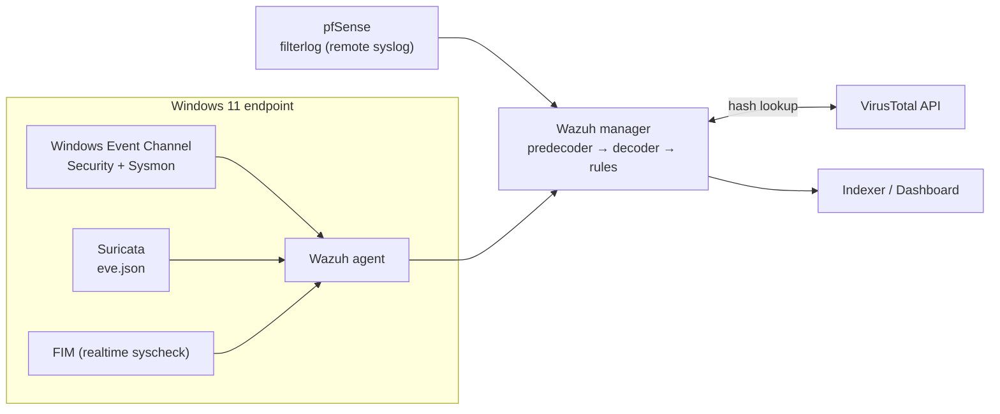

# 03 — Detection Engineering: Decoders & Rules

> Reference for every custom **decoder** and **rule** in the lab: **pfSense** (firewall), **Suricata** (network IDS) and **Sysmon / Windows Event Log** (endpoint).
> For each entry: *what it matches, why it is written that way, and where it can fail.*

**File origin**

| Type | File |
|---|---|
| Decoder (pfSense) | [`local_decoder.xml`](https://github.com/Khoavo-187/Wazuh-siem-home-lab/blob/main/siem-wazuh/custom-decoder/local_decoder.xml) |
| Wazuh rules (pfSense) | [`pfsense_rules.xml`](https://github.com/Khoavo-187/Wazuh-siem-home-lab/blob/main/siem-wazuh/custom-rules/pfsense_rules.xml) |
| Wazuh rules (Suricata wrappers) | [`suricata_rules.xml`](https://github.com/Khoavo-187/Wazuh-siem-home-lab/blob/main/siem-wazuh/custom-rules/suricata_rules.xml) |
| Wazuh rules (Sysmon & Windows events) | [`sysmon_rules.xml`](https://github.com/Khoavo-187/Wazuh-siem-home-lab/blob/main/siem-wazuh/custom-rules/sysmon_rules.xml) |
| Suricata rules | [`local.rules`](https://github.com/Khoavo-187/Wazuh-siem-home-lab/blob/main/network/Suricata_configuration/local.rules) |
| Suricata configuration | [`suricata.yaml`](https://github.com/Khoavo-187/Wazuh-siem-home-lab/blob/main/network/Suricata_configuration/suricata.yaml) |
| Sysmon configuration | [`sysmon_config.xml`](https://github.com/Khoavo-187/Wazuh-siem-home-lab/blob/main/endpoints/windows-11/sysmon_config.xml) (SwiftOnSecurity, source version 74) |
| Wazuh agent configuration | [`ossec.conf`](https://github.com/Khoavo-187/Wazuh-siem-home-lab/blob/main/endpoints/windows-11/ossec.conf) |

---

## 0. Overview

### 0.1 Data flow



| Source | Transport | Decoder | Parent rule |
|---|---|---|---|
| pfSense | Remote syslog to the manager (`192.168.60.137:514`, RFC 3164) | `pfsense-lab` + 5 child decoders (custom) | `100100` (custom) |
| Suricata (Windows endpoint) | `eve.json` → agent `localfile` (JSON) | Built-in JSON decoder | `86601` (built-in Suricata alert rule) |
| Sysmon / Security | Event Channel → agent | `windows_eventchannel` (built-in) | Built-in Sysmon / Windows rules (`sysmon_event*` groups, `60002`, `60106`, `60122`, `92302`, `92657`, `63103`) |

### 0.2 ID ranges

| Wazuh rule IDs | Source | Content |
|---|---|---|
| `100100`–`100140` | pfSense | Base, block/pass, scan, burst |
| `100200`–`100201` | pfSense | ICMP, ping sweep |
| `100300`–`100309` | Suricata | Wrappers for sids `1000002`–`1000011` |
| `100400`–`100416` | Sysmon / Windows Security | Process, network, file, registry, credential, anti-forensics |
| `1000002`–`1000011` | Suricata **sids** (not Wazuh IDs) | Network-side detections |

### 0.3 Rule attributes used in this document

| Attribute | Meaning |
|---|---|
| `if_sid` / `if_group` | Child rule: evaluated only when the parent rule (or any rule of the group) matched **on the same event** |
| `if_matched_sid` + `frequency` / `timeframe` | Correlation: fires when the target rule matched ≥ N times within T seconds |
| `same_source_ip`, `same_field`, `different_*` | Events in a correlation chain must share (or differ in) the given field |
| `ignore` | After firing, mute the rule for N seconds |
| `options no_log` | Match for chaining/correlation only; no alert is generated |
| *Evaluation order* | One event produces **at most one alert**. Wazuh walks the rule tree, takes the first matching sibling (load order: built-in rules before custom ones, then file order) and then evaluates that rule's children; the deepest match is the one reported. A parent therefore never "also fires" — it is only a precondition. Put specific rules before generic ones, or chain them with `if_sid` |

> `frequency` thresholds follow Wazuh's counting and can be off by ±1 event from the figures quoted below.

---

## 1. pfSense

### 1.1 `filterlog` format

pfSense forwards firewall logs to the manager over syslog (remote logging set to *everything*, `logall` in pfSense's `config.xml`; RFC 3164). The syslog header is not consistent: in some events the hostname is missing and Wazuh's predecoder puts `filterlog[pid]:` into the `hostname` field. That is why the parent decoder matches on the **message content** and not on `program_name`.

Sample line (IPv4 TCP):

```text
Aug  8 10:53:29 filterlog[63489]: 80,,,100000101,em1,match,pass,in,4,0x0,,128,33199,0,DF,6,tcp,52,192.168.60.101,162.159.197.3,61197,443,0,S,1576499639,,65535,,mss;nop;wscale;nop;nop;sackOK
```

| # | filterlog field | Example | Wazuh field |
|---|---|---|---|
| 1 | rule number | `80` | `pfsense.rulenum` |
| 2 | sub-rule | *(empty)* | skipped (the `,,,` in the regex) |
| 3 | anchor | *(empty)* | skipped |
| 4 | tracker | `100000101` | `pfsense.tracker` |
| 5 | interface | `em1` | `pfsense.interface` |
| 6 | reason | `match` | `pfsense.reason` |
| 7 | action | `pass` | **`action`** (static) |
| 8 | direction | `in` | `pfsense.direction` |
| 9 | IP version | `4` | `pfsense.ipversion` |
| 10 | TOS | `0x0` | `pfsense.tos` |
| 11 | ECN | *(empty)* | `pfsense.ecn` |
| 12 | TTL | `128` | `pfsense.ttl` |
| 13 | IP ID | `33199` | `pfsense.id` |
| 14 | fragment offset | `0` | `pfsense.offset` |
| 15 | IP flags | `DF` | `pfsense.flags` |
| 16 | **New, 2026-10-13**: group names in stored alerts are merged — `100406` reports `windowspersistence` and `100412` reports `windowslog_cleared`, so the groups `persistence`, `log_cleared` and `windows` are missing for them. Likely cause: the outer `<group name="sysmon_local,windows">` has no trailing comma, so Wazuh concatenates it with the first rule-level group (stock rule files end every group name with a comma; trailing commas on rule-level groups such as `shell_child,` are conventional and harmless) | Dashboards, filters and `if_group` chains on those group names miss the alerts; detection itself is unaffected | Change the outer tag to `<group name="sysmon_local,windows,">`, reload, trigger one alert and check `rule.groups`. Re-test the earlier Dashboard HTTP 500 after this change instead of attributing it to trailing commas |
| 17 | `100411` allow-list is anchored on single backslashes (`^C:\\ProgramData\\…`) while the stored `eventdata` shows doubled ones | The allow-list may never match; benign processes with a listed mask would alert at level 14; the Stage 8b test does not prove the allow-list | Verify with `wazuh-logtest` (§3.3 `100411`); use `\\+` per separator if confirmed |
| 18 | `100400` exclusion list was extended with `curl`, `bitsadmin`, `certutil` but the XML comment still says "handled by 100402"; `net`/`net1` are not excluded although `100402` covers them | `net`/`net1` from a shell are probably reported as `100400` and not counted by `100407` | Reorder (specific before generic) or exclude `net` and `net1`; re-test Stage 5 |
| 17 | protocol text | `tcp` | **`protocol`** (static) |
| 18 | length | `52` | `pfsense.length` |
| 19 | source IP | `192.168.60.101` | **`srcip`** (static) |
| 20 | destination IP | `162.159.197.3` | **`dstip`** (static) |
| 21 | source port | `61197` | **`srcport`** (static) |
| 22 | destination port | `443` | **`dstport`** (static) |
| 23 | data length | `0` | `pfsense.data_length` |
| 24+ | TCP flags, seq, ack, window, options | `S,1576499639,…` | **not decoded** |

Bold fields are Wazuh *static fields*: rules can use them directly (`<action>`, `<protocol>`, `<same_source_ip/>`, `$(srcip)`). All other fields live under `data.pfsense.*`.

Interfaces seen in the lab logs: `em1` (LAN `192.168.60.0/24`), `em0` (WAN side `192.168.254.0/24`), `lo0` (loopback).

### 1.2 Decoder tree

```text
pfsense-lab                      (parent: recognises every filterlog line)
├── pfsense-lab-ports            IPv4 TCP / UDP
├── pfsense-lab-icmp             IPv4 ICMP
├── pfsense-lab-igmp             IPv4 IGMP
├── pfsense-lab-ipv4             IPv4, any other protocol (fallback)
└── pfsense-lab-ipv6             IPv6
```

| Decoder | Prematch (short) | Extra fields (beyond the common prefix) |
|---|---|---|
| `pfsense-lab` | `filterlog\[\d+\]:\s*` | none (parent only) |
| `pfsense-lab-ports` | IPv4 + `tcp` or `udp` | `srcport`, `dstport`, `pfsense.data_length` |
| `pfsense-lab-icmp` | IPv4 + `icmp` | `pfsense.icmp_type`, `pfsense.icmp_id`, `pfsense.icmp_seq` |
| `pfsense-lab-igmp` | IPv4 + `igmp` | none (stops at `dstip`) |
| `pfsense-lab-ipv4` | IPv4, protocol ∉ {tcp, udp, icmp, igmp} | none (stops at `dstip`) |
| `pfsense-lab-ipv6` | IPv6 (`,6,`) | `pfsense.class`, `pfsense.flowlabel`, `pfsense.hoplimit` |

#### `pfsense-lab` — parent
- PCRE2 prematch `filterlog\[\d+\]:\s*` finds `filterlog[<pid>]:` anywhere in the line.
- Children use `offset="after_parent"`: their regex starts **after** `filterlog[pid]: `, so the (variable) syslog header never needs to be parsed.

#### `pfsense-lab-ports` — IPv4 TCP / UDP
- Prematch: `\d+,,,.*?,4,.*?,(?:tcp|udp),` — rule number followed by `,,,` (empty sub-rule and anchor), version `4`, protocol `tcp` or `udp`.
- The regex has 21 capture groups mapped one-to-one to the 21 names in `<order>`.
- The `(tcp|udp)` group fills the static field `protocol`, which lets rule `100140` filter on `^tcp$`.
- UDP example: `76,,,1000002661,em0,match,pass,out,4,0x0,,63,4250,0,none,17,udp,64,192.168.254.101,8.8.8.8,20455,53,44` → `srcip=192.168.254.101`, `dstip=8.8.8.8`, `dstport=53`, `pfsense.data_length=44`.

#### `pfsense-lab-icmp` — IPv4 ICMP
- After `dstip`, an ICMP echo carries three fields: type (`request` / `reply`), id, sequence.
- Example: `74,,,1000002565,em1,match,pass,out,4,0x0,,64,40058,0,none,1,icmp,84,192.168.60.254,192.168.60.101,request,40169,064` → `pfsense.icmp_type=request`, `pfsense.icmp_id=40169`, `pfsense.icmp_seq=064`.

#### `pfsense-lab-igmp` — IPv4 IGMP
- Extracts up to `dstip` and ignores the options that follow. Purpose: multicast traffic (`224.0.0.x`) is decoded instead of falling through to the generic fallback.

#### `pfsense-lab-ipv4` — IPv4 fallback
- Catches every remaining IPv4 protocol (ESP, GRE, OSPF, …).
- The protocol group uses a negative lookahead `((?!(?:tcp|udp|icmp|igmp),)[^,]+)` to **exclude** the four protocols that already have a dedicated decoder, so the child decoders never overlap.

#### `pfsense-lab-ipv6` — IPv6
- Differences from IPv4: after the version come `class`, `flowlabel`, `hoplimit`, and the **protocol text comes before the protocol ID** (reverse of IPv4). The regex mirrors that with `([^,]+),(\d+)`.
- Extracts up to `srcip` / `dstip`; no ports.

#### Decoder limitations

| # | Limitation | Consequence |
|---|---|---|
| 1 | TCP flags (`S`, `SA`, `F`, …) are not extracted | SYN cannot be told apart from other packets; `100140` counts logged `pass` events rather than SYNs |
| 2 | The ICMP decoder only matches echo (`type,id,seq`) | Other ICMP types (unreachable, time-exceeded, …) use a different layout and would need their own decoder to get `srcip`/`dstip` — *confirm with `wazuh-logtest`* |
| 3 | `sub-rule` and `anchor` must be empty (`,,,`) | Events from rules inside an anchor are not decoded |
| 4 | No ports for IPv6 | IPv6 port scans are invisible |
| 5 | Loose prematch (`.*?,4,` can match by accident) | Harmless, because the regex that follows pins every position; anchoring with `^` would be a cheap optimisation |

### 1.3 pfSense rules

```text
filterlog ─► 100100 (base, no_log)
              ├─► 100101 block ──► 100102  ≥10 blocks / 60s, same source
              ├─► 100110 pass  ──► 100140  ≥15 connections / 10s, same src → dst:port (TCP)
              ├─► 100200 ICMP  ──► 100201  ≥8 ICMP / 30s, same source, many destinations
              └─► 100130  ≥15 events / 30s, same source, many different dst ports (any action)
```

| ID | Level | Condition | Correlation | MITRE |
|---|---|---|---|---|
| `100100` | 1 (`no_log`) | `decoded_as pfsense-lab` | none | none |
| `100101` | 5 | `action = block` | none | none |
| `100102` | 10 | rule `100101` | ≥10 / 60s, `same_source_ip`, `ignore 120` | T1046 |
| `100110` | 3 (`no_log`) | `action = pass` | none | none |
| `100130` | 10 | any `100100` event | ≥15 / 30s, `same_source_ip`, `different_dstport`, `ignore 120` | T1046 |
| `100140` | 6 | rule `100110` + `protocol = tcp` + `dstport` in `{22,23,445,3389,5900,1433,3306}` | ≥15 / 10s, same src, dst, dstport, `ignore 60` | none |
| `100200` | 3 (`no_log`) | `protocol = icmp` | none | none |
| `100201` | 8 | rule `100200` | ≥8 / 30s, `same_source_ip`, `different_dstip`, `ignore 120` | T1018 |

#### `100100` — Firewall log detected (level 1, `no_log`)
Root of the whole pfSense tree. `no_log` keeps thousands of level-1 alerts out of the index, while the rule still serves as the parent for the `if_sid` / `if_matched_sid` rules below.

#### `100101` — Traffic blocked (level 5)
- `if_sid 100100` + `<action>block</action>` (`action` is the static field from column 7 of filterlog).
- One alert per blocked packet; the description carries the 5-tuple `$(srcip):$(srcport) -> $(dstip):$(dstport)`.
- Limitation: only `block` is matched; `reject` (pfSense answers with RST/ICMP) is not covered.

#### `100102` — Multiple firewall blocks (level 10)
- Correlation on `100101`: ≥10 packets blocked from the same `srcip` within 60s → scan or brute force against closed ports. Mapped to T1046.
- `ignore 120` mutes the rule for 120s after it fires.

#### `100110` — Traffic allowed (level 3, `no_log`)
Not meant to alert. It is the link that lets `100140` count allowed connections.

#### `100130` — Possible port scan, many destination ports (level 10)
- Correlation over **all** pfSense events (`100100`, pass and block): same `srcip`, ≥15 different `dstport` values within 30s. Mapped to T1046.
- Detects scans by **behaviour** (diversity of destination ports) instead of by action, so it still fires when ports are open and traffic is passed (where `100102` sees nothing).
- Limitation: an internal host legitimately reaching many services at once can cross the threshold.
- Lab trigger: `nmap -sS -p1-1000 <target>` from Kali.

#### `100200` — ICMP ping detected (level 3, `no_log`)
- `if_sid 100100` + `<protocol>^icmp$</protocol>`.
- Purpose: record pings and feed `100201`. Fixed to level 3 + `no_log` (was level 7, alerting on every ICMP packet including pfSense's own gateway monitoring) — only `100201` (the correlation) now alerts.

#### `100201` — Ping sweep (level 8)
- Correlation on `100200`: same `srcip`, ≥8 different `dstip` within 30s. Mapped to T1018 (Remote System Discovery).
- Lab trigger: `nmap -sn 192.168.60.0/24`.

#### `100140` — TCP connection burst (level 6)
- Correlation on `100110`: same `srcip`, `dstip`, `dstport`, `protocol = tcp`, `dstport` restricted to administrative services (`22` SSH, `23` Telnet, `445` SMB, `3389` RDP, `5900` VNC, `1433` MSSQL, `3306` MySQL), ≥15 events within 10s.
- Meaning: flood or brute force against **one** admin service. pfSense is stateful and logs only the packet that creates the state, so the number of `pass` events approximates the number of new connections.
- "SYN burst" is only approximate, because TCP flags are not decoded (limitation #1).
- Fixed: originally matched *any* destination port, which made ordinary HTTPS bursts to a single CDN endpoint (e.g. a browser opening many parallel connections to one server on port 443) cross the threshold. Restricting `dstport` to the admin-service list above removed that false positive; re-check this list if new internal services are added.

---

## 2. Suricata

### 2.1 Sensor and configuration

The rules and configuration published in this repo belong to the Suricata instance running on the **Windows 11 endpoint** (`default-rule-path: C:\Program Files\Suricata\rules\`). The second instance on the pfSense WAN interface is not part of the repo.

Settings in [`suricata.yaml`](https://github.com/Khoavo-187/Wazuh-siem-home-lab/blob/main/network/Suricata_configuration/suricata.yaml) that shape every rule below:

| Setting | Value | Effect |
|---|---|---|
| `HOME_NET` | `[192.168.60.0/24, !192.168.60.135]` | The whole LAN **except Kali** (`.135`) |
| `EXTERNAL_NET` | `!$HOME_NET` | In practice: Kali plus the Internet |
| `rule-files` | `local.rules` (the committed file also lists `emerging-all-fixed.rules` — confirm whether it is loaded in the validated runs) | Alerts from other rule sets are not wrapped by the custom rules; all evidence in this repo comes from sids `1000002`–`1000011` |
| `eve-log` | enabled (`alert`, `http`, `dns`, `tls`, `files`, …) → `eve.json` | `eve.json` is the file the Wazuh agent tails |

Why `HOME_NET` excludes Kali: with Kali inside `$HOME_NET`, rules written as `$HOME_NET → any` (reverse shell ports) fired on Nmap scans run **from** the attacker. Removing the attacker from `$HOME_NET` makes it an `$EXTERNAL_NET` source, so the inbound rules (`1000002`, `1000003`) fire on Kali and the outbound rules no longer fire on Kali's own traffic.

### 2.2 Rule inventory

| sid | Detection | Match | Wazuh rule | Level | MITRE |
|---|---|---|---|---|---|
| `1000002` | Port scan | SYNs from `$EXTERNAL_NET` to `$HOME_NET`, ≥15 in 10s per source | `100300` | 5 | T1595 |
| `1000003` | SSH attempts | SYNs to port 22, ≥5 in 60s per source | `100301` | 8 | T1110 |
| `1000004` | RDP attempt | SYNs to port 3389, ≥5 in 60s per source | `100302` | 6 | T1133 |
| `1000005` | SMB probe | SYNs to port 445, ≥5 in 60s per source | `100303` | 6 | T1046 |
| `1000006` | Reverse shell ports | Established outbound traffic to `4444, 1337, 31337, 5555` | `100304` | 12 | T1071 |
| `1000007` | curl user-agent | Any HTTP request whose User-Agent contains `curl` | `100305` | 5 | T1592 |
| `1000008` | EICAR download | HTTP response body contains the EICAR prefix | `100306` | 10 | T1105 |
| `1000009` | DNS test domain | DNS query for `malware-test.local` | `100307` | 9 | T1071.004 |
| `1000010` | Windows shell banner | Outbound payload contains the `cmd.exe` banner | `100308` | 12 | T1071 |
| `1000011` | curl download of script/binary | `curl` user-agent + URI ending in `.sh/.ps1/.exe/.bat/.dll` | `100309` | 8 | T1105 |

### 2.3 Anatomy of a rule (sid 1000002)

```text
alert tcp $EXTERNAL_NET any -> $HOME_NET any (
  msg:"LOCAL Possible Port Scan - Multiple SYN in short time";
  flow:to_server; flags:S;
  threshold:type both, track by_src, count 15, seconds 10;
  classtype:attempted-recon;
  metadata:mitre_tactic_id TA0043, mitre_technique_id T1595;
  sid:1000002; rev:3;)
```

| Part | Meaning |
|---|---|
| `alert tcp $EXTERNAL_NET any -> $HOME_NET any` | Action, protocol, source (address, port) → destination (address, port) |
| `flow:to_server` | Client-to-server direction only |
| `flags:S` | Exactly SYN — excludes SYN-ACK, so only connection **initiations** count |
| `threshold:type both, track by_src, count 15, seconds 10` | Alert once when a source reaches 15 matches within 10s, then stay quiet until the window ends |
| `classtype` | Category used for Suricata's priority and reporting |
| `metadata` | MITRE tags, carried into `eve.json` under `alert.metadata` |
| `sid` / `rev` | Rule identifier (local range ≥ 1,000,000) and revision |

### 2.4 Rule by rule

#### `1000002` — Possible port scan
Counts SYN-only packets: ≥15 from one source within 10s. Depends on `$EXTERNAL_NET` — only Kali (or the Internet) can trigger it. Trigger: `nmap -sS <target>` from Kali.

#### `1000003` — Repeated SSH connection attempts
Same idea, destination port 22, lower threshold (5 per 60s). It counts **connection attempts**, not failed logins, so it fits brute-force tooling such as Hydra. Mapped to T1110.

#### `1000004` — RDP connection attempt
Source is `any`, so internal hosts are covered too. Counts SYNs to 3389 (≥5 per 60s). Mapped to T1133 (External Remote Services).

#### `1000005` — SMB port probe
Same pattern on port 445. The metadata pairs T1046 (Network Service Discovery) with `TA0043`, but T1046 belongs to **Discovery (TA0007)**, not Reconnaissance — fix the tactic ID.

#### `1000006` — Possible reverse shell, suspicious outbound port
- Source `$HOME_NET` → any, ports `4444` (Metasploit default), `1337`, `31337`, `5555`.
- Revision 3 replaced `flags:S` with `flow:to_server,established`, so only connections that completed the handshake match. This removed the false positives caused by Nmap SYN scans (a half-open probe never reaches `established`).
- Add `threshold:type limit, track by_dst, count 1, seconds 60` to get one alert per flow window.
- Port lists are easy to evade (see the README's *Detection Philosophy*); `1000010` complements it.

#### `1000007` — Recon tool user-agent (curl)
Matches `curl` in the HTTP User-Agent for any source and destination. Low fidelity: `curl` is also a legitimate admin and developer tool, so treat the alert as context, not a verdict.

#### `1000008` — EICAR test file over HTTP
`file_data` inspects the HTTP response body; the content match `X5O!P%@AP[4` is the beginning of the standard EICAR string. Direction `to_client` towards `$HOME_NET` means a host in the lab **downloaded** the file. HTTP only: HTTPS bodies are not visible.

#### `1000009` — DNS query to suspicious test domain
`dns.query` buffer, `nocase` match on `malware-test.local`. It is a lab marker for the C2-over-DNS pattern (T1071.004), not a real indicator. It sees only DNS that crosses the sensor.

#### `1000010` — Reverse shell banner (Windows)
- Behavioural rule: matches the banner a Windows `cmd.exe` prints when a shell starts (`Microsoft Windows [Version …]` followed within 100 bytes by `(c) Microsoft Corporation`), sent **outbound** on an established connection, on **any port** (so it still works when the shell uses 80 or 443).
- Limits: plain-text traffic only; matches the `cmd.exe` banner, not the PowerShell one (`Windows PowerShell` / `Copyright (C)`), even though the message says "CMD/Powershell"; a reverse shell that prints no banner is not seen.

#### `1000011` — Suspicious download via curl
`curl` user-agent plus a URI ending in `.sh`, `.ps1`, `.exe`, `.bat` or `.dll`, from `$HOME_NET` to `$EXTERNAL_NET` (in the lab: the endpoint pulling a payload from Kali). The `$` anchor means a trailing query string (`?x=1`) defeats the match. It overlaps with `1000007`, so one request can raise both alerts.

### 2.5 Wazuh wrapper rules

Every wrapper has the same shape:

```xml
<rule id="100300" level="5">
  <if_sid>86601</if_sid>
  <field name="alert.signature_id">1000002</field>
  <description>Suricata: Possible Port Scan from $(src_ip)</description>
  <mitre><id>T1595</id></mitre>
  <group>recon,network_scan</group>
</rule>
```

- `86601` is Wazuh's built-in parent for Suricata `alert` events; the wrapper narrows it to a single `alert.signature_id`.
- `$(src_ip)` and `$(dest_port)` come from the JSON fields of `eve.json`.
- Level and MITRE ID are assigned here (not in Suricata), so severity can be tuned without touching the sensor.
- The `field` value is a pattern match, not an equality test. Anchor it (`^1000002$`) so a future sid such as `10000021` cannot match by accident.

#### `100308` / `100309` — wrappers for sids `1000010` and `1000011`
Added after the initial baseline review (both sids originally had no Wazuh wrapper, so their alerts were unclassified and unscored):

```xml
<rule id="100308" level="12">
  <if_sid>86601</if_sid>
  <field name="alert.signature_id">1000010</field>
  <description>Suricata: Windows shell banner sent outbound - possible reverse shell from $(src_ip) to $(dest_ip):$(dest_port)</description>
  <mitre><id>T1071</id></mitre>
  <group>command_and_control,reverse_shell</group>
</rule>

<rule id="100309" level="8">
  <if_sid>86601</if_sid>
  <field name="alert.signature_id">1000011</field>
  <description>Suricata: curl download of script or executable from $(src_ip)</description>
  <mitre><id>T1105</id></mitre>
  <group>command_and_control,download_execution</group>
</rule>
```

Same shape as the other eight wrappers; `100308` maps the banner rule (T1071, level 12 — a reverse shell banner is a strong signal), `100309` maps the curl-download rule (T1105, level 8).

---

## 3. Sysmon & Windows Security events

### 3.1 Telemetry requirements

A Wazuh rule can only fire if the event exists. The Sysmon configuration is [`sysmon_config.xml`](https://github.com/Khoavo-187/Wazuh-siem-home-lab/blob/main/endpoints/windows-11/sysmon_config.xml) (SwiftOnSecurity, source version 74, Sysmon 13+). The agent ships the `Microsoft-Windows-Sysmon/Operational`, `Security`, `System` and `Application` channels (see [`ossec.conf`](https://github.com/Khoavo-187/Wazuh-siem-home-lab/blob/main/endpoints/windows-11/ossec.conf)).

| Event | Used by | What `sysmon_config.xml` does | Effect on the rules |
|---|---|---|---|
| **1** ProcessCreate | `100400`–`100403`, `100407` | `onmatch="exclude"`: everything is logged except the listed noise | Covered |
| **3** NetworkConnect | `100404`, `100413`, `100414` | Include list: specific images (`powershell.exe`, `cmd.exe`, `certutil.exe`, `bitsadmin.exe`, `nc.exe`, …), any binary under `C:\Users`, `C:\ProgramData`, `C:\Windows\Temp`, and a port list (22, 3389, 4444, 5900, …). Excludes Defender, Teams, `*.microsoft.com`, loopback | `100404` and `100414` are covered because PowerShell / cmd / certutil are included. `100413` is active and record base on extract data rule detection with all port list |
| **10** ProcessAccess | `100411`, `100416` | `include` filter on `\lsass.exe` (fixed — was empty) | Covered, and now confirmed live by a false-positive test (see §3.3, `100411`) |
| **11** FileCreate | `100405` | Include by extension and folder (`.exe`, `.dll`, `.ps1`, `.bat`, `\Downloads\`, `\Startup\`, …); no generic `\Temp\` or `\AppData\Roaming\` filter | The rule only sees files already selected by extension/folder, so in practice it flags **executables and scripts** written to Temp or Roaming |
| **13** RegistryEvent | `100406` | Includes `CurrentVersion\Run` (covers `Run`, `RunOnce`, …) | Covered |
| Security **4625 / 4624 / 1102** | `100408`, `100410`, `100412` | Not Sysmon — Windows Security log | Needs the `Security` channel (present) and the matching audit policy |

> SwiftOnSecurity's `name=` tags use the legacy technique IDs of 2021 (for example `T1060`, today `T1547.001`). Use the MITRE IDs from the Wazuh rules, not those tags.

### 3.2 Field names

Wazuh's `windows_eventchannel` decoder exposes Sysmon and Security data under `win.eventdata.*` and `win.system.*` with a lower-case first letter: `parentImage`, `image`, `commandLine`, `user`, `targetFilename`, `targetObject`, `destinationIp`, `destinationPort`, `sourceImage`, `targetImage`, `ipAddress`, and `win.system.eventID`.

The rules chain on built-in groups whose names are not consistent (`sysmon_event1`, `sysmon_event3`, but `sysmon_event_10`, `sysmon_event_11`, `sysmon_event_13`). Verify them against your Wazuh version (see §6).

### 3.3 Rules

| ID | Level | Trigger | Correlation | MITRE |
|---|---|---|---|---|
| `100400` | 5 | EID 1, `parentImage` ends with `powershell.exe`, `pwsh.exe`, `cmd.exe` or `net.exe`; excludes `image` `whoami`, `systeminfo`, `tasklist`, `nltest`, `curl`, `bitsadmin`, `certutil` | none | none |
| `100401` | 10 | EID 1, `image` ends with `powershell.exe`, command line matches an encoded-command switch (`-e`/`-ec`/`-en…`) followed by ≥20 non-space chars | none | T1027, T1059.001 |
| `100402` | 6 | EID 1, image `whoami`, `systeminfo`, `tasklist`, `nltest`, `net` or `net1` | none | T1033, T1082, T1087 |
| `100403` | 8 | EID 1, image `certutil` or `bitsadmin` | none | T1105 |
| `100415` | 12 | Child of `100403`, command line matches a download/decode switch (`urlcache`, `verifyctl`, `decode[hex]`, `transfer`, `addfile`, `setnotifycmdline`) | none | T1105 |
| `100404` | 7 | EID 3, image `powershell` or `cmd` | none | T1071 |
| `100405` | 7 | EID 11, path contains `\Temp\` or `\AppData\Roaming\` | none | T1105 |
| `100406` | 10 | Child of built-in `92302`, key `…\CurrentVersion\Run` or `RunOnce` | none | T1547.001 |
| `100407` | 12 | Rule `100402` | ≥3 / 120s, `same_field` user | T1087 |
| `100408` | 10 | Rule `60122` (event 4625) with `ipAddress` ≠ `-` | ≥5 / 60s, `same_field` `ipAddress`, `ignore 120` | T1110 |
| `100410` | 13 | Logon success `4624` (`92657`) after `100408` | `frequency=1` / 200s in the live XML (intended 1 — see §5 item 5), `same_field` `ipAddress` | T1110, T1078 |
| `100411` | 14 | EID 10, `targetImage` ends with `lsass.exe`, `sourceImage` not in the full-path allow-list, `grantedAccess` in a memory-read mask list | none | T1003.001 |
| `100416` | 15 | Child of `100411`, `callTrace` contains `dbghelp.dll`/`dbgcore.dll` or `UNKNOWN` | none | T1003.001 |
| `100412` | 15 | Child of built-in `60002` (Security-channel base), `eventID = 1102` | none | T1070.001 |
| `100413` | 9 | Child of built-in `60009`; event with PowerShell module-logging fields (`contextInfo` containing `Invoke-WebRequest`, plus `payload`) — **needs a channel and the file `ossec.conf` is configured for collect logs for powershell command (but it not yet test)** | none | T1059.001, T1567.002 |
| `100414` | 12 | EID 3, image `powershell` or `certutil`, port `80` or `443` | none | T1041, T1105 |

#### `100400` — Shell spawned child process (level 5)
`if_group sysmon_event1` plus a PCRE2 match on `parentImage`. The description shows parent, child, command line and user, which gives the process lineage in one line. **No longer a parent of `100401`** (see below — that rule is now independent). Scheduled tasks and management agents that wrap a shell also trigger it, so keep it at a low level.

Fixed, 2026-10-13: the `description` field was missing a closing `)` on `$(win.eventdata.user` (truncated the rendered alert text; cosmetic, rule logic was unaffected) — confirmed fixed via a raw re-test alert (`docs/04`, Stage 5). Renamed from "PowerShell spawned process" / group `powershell_child` to "Shell spawned child process" / group `shell_child`, and `parentImage` is **confirmed widened** to `(?i)(?:powershell|pwsh|cmd|net)\.exe$` (was `(?i)powershell\.exe$` only) — a `100400` alert with `cmd.exe` as parent is captured in `docs/04`, Stage 10 (Figure 16). A negated `image` field excludes `whoami`, `systeminfo`, `tasklist`, `nltest`, `curl`, `bitsadmin` and `certutil` so that the more specific rules are not shadowed by `100400` (the XML comment still says \"handled by 100402\", which is no longer accurate for the last three).

#### `100401` — Encoded PowerShell command (level 10)
Fixed: originally a child of `100400` (only fired when the process was *started by PowerShell*, missing `cmd.exe → powershell -enc …` or `explorer.exe → powershell -enc …`) and only matched `-enc`/`-encodedcommand`/`-e`, missing abbreviations like `-ec`/`-en`. Now independent (`if_group sysmon_event1`, no parent dependency) with a wider switch pattern:

```xml
<field name="win.eventdata.image" type="pcre2">(?i)powershell\.exe$</field>
<field name="win.eventdata.commandLine" type="pcre2">(?i)(?:^|\s)[-/](?:e|ec|en[a-z]*)\s+\S{20,}</field>
```

`[-/](?:e|ec|en[a-z]*)` accepts `-e`, `-ec`, `-enc`, `-encodedcommand`, and the `/` variant; `\S{20,}` requires a long non-space payload after the switch, so it still needs the Base64-looking argument to avoid matching ordinary short flags. Encoding hides the payload from simple string detection (T1027) while running PowerShell (T1059.001).

#### `100402` — Reconnaissance binary (level 6)
EID 1 where `image` ends with `whoami`, `systeminfo`, `tasklist`, `nltest`, `net` or `net1`. These are standard discovery tools (T1033 system owner, T1082 system information). Individually they are normal admin activity, hence the low level and the correlation in `100407`.

**Scope widened, 2026-10-13.** Originally missed `net.exe`/`net1.exe`/`arp.exe` (the account-discovery and network-neighbour commands actually run in the Stage 5 emulation) — this was a scope gap, not a precedence issue (unlike `100406`/`100410`/`100412` above). `net.exe`/`net1.exe` are now confirmed in the pattern via a raw-alert re-test (`docs/04`, Stage 5). **Confirmed absent**: `arp.exe` is not in the pattern (current rule XML reviewed directly) — in the re-test it only triggered the generic `100400` ("Shell spawned child process"), not `100402`. Add `arp` to the pattern if parity with `net`/`net1` is wanted; one token.

**Precedence caveat (verify).** One event produces one alert and Wazuh stops at the first matching sibling. In the live XML `100400` comes before `100402` and its exclusion list does **not** contain `net`/`net1`, so a `net`/`net1` process started from PowerShell, `cmd` or `net.exe` should be reported as `100400`, not `100402`, and `100407` would not count it. The 2026-10-13 alerts (net/net1 → `100402`) predate the current exclusion list. Either add `net` and `net1` to `100400`'s exclusion, or place `100402` before `100400`, then re-run Stage 5 and confirm with `wazuh-logtest`.

#### `100403` — LOLBin download/decode (level 8)
EID 1 for `certutil.exe` or `bitsadmin.exe`, both able to fetch or decode files (T1105). The rule does not inspect arguments, so legitimate certificate operations also match — kept deliberately low-fidelity as a base signal; `100415` below adds the high-fidelity child.

#### `100415` — LOLBin with download/decode arguments (level 12)
Child of `100403` (`if_sid 100403`). Narrows to command lines containing `urlcache`, `verifyctl`, `decode`/`decodehex`, `transfer`, `addfile` or `setnotifycmdline` — the switches `certutil`/`bitsadmin` actually use to fetch or persist a payload (T1105; see the dedicated walkthrough of how each switch is abused, covered earlier in this project). Still argument-only: it does not check the URL or output path, so a legitimate `-decode` in an install script can still match.

#### `100404` — Outbound connection from PowerShell / cmd (level 7)
EID 3 where the image is `powershell.exe` or `cmd.exe`. Shells rarely need direct network access, so any connection is worth a look (T1071). `sysmon_config.xml` includes these images, so the event is available for any destination port.

#### `100405` — File created in a sensitive path (level 7)
EID 11 with `targetFilename` containing `\Temp\` or `\AppData\Roaming\`. As explained in §3.1, Sysmon only logs executable/script extensions and a few folders, so the effective detection is *"executable or script dropped into Temp/Roaming"* (T1105).

#### `100406` — Registry Run key persistence (level 10)
`targetObject` matching `(?i)\\CurrentVersion\\(?:Run|RunOnce)(?:\\|$)` (T1547.001). Covers both HKLM and HKCU. Other autostart locations (`Winlogon`, `Policies\Explorer\Run`, services) are logged by Sysmon but not matched by this rule.

**Chained under the built-in rule, not a sibling of it.** The first version used `<if_group>sysmon_event_13</if_group>`, making it a sibling of Wazuh's own built-in registry-Run-key rule (`92302`, same group). A 2026-08-28 test run showed `92302` firing instead of `100406` for a real Run-key write — Wazuh evaluates sibling rules under one group and settles on a single match, and the built-in rule won. The fix: `<if_sid>92302</if_sid>` instead of the group tag, so `100406` is only evaluated **after** `92302` has already matched (a child, not a competitor). **Confirmed working, 2026-10-13**: a re-test produced a raw `100406` alert (level 10). A built-in `92041` ("Base64-like pattern") alert appears about 1 ms earlier; one event yields one alert, so these are most likely two separate Sysmon events — compare their `eventRecordID`s (the exported `100406` record is `2875786`). Only the deepest matching rule alerts, so no separate `92302` alert is expected. See `docs/04`, Stage 7.

#### `100407` — Multiple reconnaissance commands (level 12)
Correlation on `100402`: ≥3 recon binaries from the same `win.eventdata.user` within 120s. A single `whoami` is routine; a burst of discovery commands is **active enumeration** (T1087). It depends on `100402` actually being the rule that fires for those events (see precedence note, §5 item 2).

#### `100408` — Failed logon burst (level 10)
Correlation on rule `60122` (failed logon, event 4625): ≥5 failures from the same `ipAddress` within 60s. Entries with `ipAddress` equal to `-` (local logons without a source address) are excluded by a negated field match. Mapped to T1110. It fits network logons (RDP, SMB, OpenSSH for Windows).

#### `100410` — Successful Logon After a Failed-Logon Burst (Level 13)

**Detection objective.**

Rule `100410` is designed to identify a successful Windows authentication event (Event ID `4624`) following a previously detected burst of failed authentication attempts from the same source IP address.

This sequence may indicate that an attacker successfully authenticated after repeated password-guessing attempts.

The detection is mapped to MITRE ATT&CK techniques:

- **T1110 — Brute Force**
- **T1078 — Valid Accounts**

**Detection logic.**

The intended correlation sequence is:

```text
Multiple Failed Logons (Event ID 4625)
                   |
                   v
       Wazuh Rule 100408
       Brute-force Detection
                   |
                   v
     Successful Logon (4624)
                   |
                   v
      Built-in Rule 92657
                   |
                   v
           Rule 100410
    Success After Brute Force
```

The current rule configuration uses:

- `<if_sid>92657</if_sid>` — evaluates successful authentication events classified by Wazuh's built-in rule `92657`.
- `<if_matched_sid>100408</if_matched_sid>` — references a previously matched brute-force detection.
- `frequency="1"` and `timeframe="200"` — configured correlation parameters, requiring validation against the installed Wazuh version.
- `<same_field>win.eventdata.ipAddress</same_field>` — intended to correlate authentication events originating from the same source IP address.
- `win.system.eventID = 4624` — restricts the current event to successful Windows logons.

**Previous issue and configuration changes.**

During the October 10, 2026 retest, rule `100408` successfully detected repeated failed authentication attempts. A subsequent Event ID `4624` was also observed, but Wazuh generated the built-in alert `92657` instead of the expected custom alert `100410`.

The earlier configuration used:

```xml
<if_sid>60106</if_sid>
```

This raised a possible rule-chain interaction with the built-in authentication detection.

The configuration was subsequently changed to:

```xml
<if_sid>92657</if_sid>
<if_matched_sid>100408</if_matched_sid>
```

The correlation parameters were also updated to:

```xml
frequency="1" timeframe="200"
```

These changes align the custom rule with the built-in alert observed during the SMB authentication test.

**Detection limitations.**

1. The current rule depends on built-in rule `92657`. Authentication events that do not match this parent rule may not reach `100410`.

2. Matching the source IP address does not necessarily establish that the same user account was involved in both the failed and successful authentication events.

3. The relationship between the historical `100408` alert and the subsequent successful logon must be validated to ensure that the correlation behaves as intended.

4. A successful authentication following failed attempts is suspicious but does not independently prove that credentials were compromised.

**Validation status — Pending Retest.**

The configuration has been updated, but successful execution of rule `100410` has not yet been confirmed by a new raw alert produced after these changes.

The October 10, 2026 evidence confirms:

- Rule `100408` detected repeated failed logons.
- A subsequent successful Windows authentication event occurred.
- Built-in rule `92657` generated an alert.
- Custom rule `100410` did not produce the expected correlation alert during that test.

A new validation test is required to confirm the updated rule behavior.

**Evidence:** See `docs/04-threat-emulation-report.md`, Stages 2–3.
#### `100411` — LSASS memory access (level 14)
EID 10 where `targetImage` ends with `lsass.exe` (T1003.001). Two conditions narrow it, both tightened since the first draft:
- `sourceImage` allow-list by **full executable path** (`C:\Windows\System32\svchost.exe`, `taskmgr.exe`, `wininit.exe`, `csrss.exe`, `services.exe`, `wbem\WmiPrvSE.exe`, plus the Defender `MsMpEng.exe` paths) — fixed from an earlier version that matched by file name only (`(?:taskmgr|svchost|MsMpEng)\.exe$`), which a malicious binary could trivially spoof by using the same name in a different folder.
- `grantedAccess` restricted to a list of access masks that allow reading process memory (`0x1010`, `0x1410`, `0x1438`, `0x143a`, `0x1f0fff`, `0x1f1fff`, `0x1f3fff`, `0x1fffff`) — excludes masks like `0x1000`/`0x1400` that only query process information.

**Telemetry fixed and confirmed live, 2026-10-13 — filters not yet proven.** `sysmon_config.xml`'s `ProcessAccess` section was empty (no EID 10 logged at all) — it now has an `include` filter on `\lsass.exe`, and a false-positive test (Windows Defender's `MsMpEng.exe` reading `lsass.exe` during a routine scan) shows the event reaching the rule engine: the built-in `92900` fired and `100411` stayed silent (`docs/04`, Stage 8b). **Silence is not proof that each filter works.** Three independent things could explain it: the `grantedAccess` mask (`0x101000` is not in the list — the only cause proven), the `sourceImage` allow-list, or the `if_group` name `sysmon_event_10` not matching at all. The exported alert also shows doubled backslashes in `eventdata` (`C:\\ProgramData\\Microsoft\\…` after JSON decoding, while `message` has single ones) whereas the allow-list expects single ones (`^C:\\ProgramData\\…`), so the allow-list may never match and benign allow-listed processes using a listed mask would alert at level 14. **Test it with `wazuh-logtest`**: feed the stored `full_log` of the Defender event unchanged (expect `92900`), then again with `sourceImage` replaced by a non-allow-listed path and `grantedAccess` set to `0x1fffff` (expect `100411`). If the stored path really contains doubled backslashes, loosen each separator to `\\+`. No real dump tool has been run (`procdump.exe` is not staged), so Stage 8b in `docs/04` remains ⚠️.

#### `100416` — LSASS access with memory-dump call trace (level 15)
Child of `100411` (`if_sid 100411`). Raises severity when `callTrace` contains `dbghelp.dll` or `dbgcore.dll` (the DLLs behind `MiniDumpWriteDump`) or the literal string `UNKNOWN` (code running from unbacked memory — also seen with JIT'd .NET code, so treat `UNKNOWN` alone as weaker signal than the DLL match). Not yet exercised by a real test — the one `ProcessAccess` event captured so far (Defender's own scan) stays entirely inside `mpengine.dll` and system DLLs, so it would not have triggered `100416` even if `100411` had fired for it.

#### `100412` — Security log cleared (level 15)
`win.system.eventID = 1102` (audit log cleared). Clearing the log is anti-forensics (T1070.001), hence the highest level in the set.

**Parent reference was wrong, now corrected.** The rule originally chained from `60117` — this turned out not to be a confirmed ancestor of eventchannel Security events, so `100412` may never have been reached in the rule tree at all for the real `1102` event (a different problem from sibling precedence: the parent itself likely never matched). Per Wazuh's own documented eventchannel chain (all eventchannel logs → `60000` → Security channel specifically → `60002`), `if_sid` is now `60002`, a confirmed real ancestor. **Confirmed working, 2026-10-13.** The built-in `63103` fired instead of `100412` in the original 2026-08-28 evidence (captured when the rule still used `60117`); after the `if_sid=60002` fix, a re-test produced two raw `100412` alerts at the intended level 15, with no `63103` row visible in the same Discover view. See `docs/04`, Stage 10.

#### `100413` — PowerShell `Invoke-WebRequest` Activity (Level 9)

Rule `100413` is designed to identify PowerShell activity involving `Invoke-WebRequest` through PowerShell Module Logging (Event ID `4103`).

The custom rule uses regular-expression matching against the `contextInfo` field and requires the associated `payload` field. It references Wazuh's built-in rule `60009` and is mapped to MITRE ATT&CK technique **T1059.001 (PowerShell)**.

**Current implementation status:**

- **Detection logic:** Implemented in `sysmon_rules.xml`.
- **Log collection:** The `Microsoft-Windows-PowerShell/Operational` channel has been added to the Wazuh Agent configuration.
- **Module Logging:** Not yet confirmed as enabled on the Windows endpoint.
- **Parent rule:** The compatibility of built-in rule `60009` has not yet been verified.
- **Detection validation:** No confirmed raw alert for rule `100413` is currently available.

**Stage 11 alignment:**

The Stage 11 Windows script has been updated to use `Invoke-WebRequest` instead of the previous `System.Net.Sockets.TCPClient` implementation.

The script compresses a FIM-monitored directory and attempts to transfer the generated archive to a Kali-hosted HTTP endpoint using an HTTP POST request.

This aligns the simulated PowerShell activity with the command targeted by rule `100413`.

However, the current Kali HTTP listener does not implement POST upload handling, so successful file reception has not yet been validated.

**Detection limitations:**

The presence of `Invoke-WebRequest` indicates PowerShell HTTP activity but does not independently confirm data exfiltration.

Successful detection also depends on Module Logging being enabled, the required event fields being collected, and the Wazuh rule chain matching correctly.

**Next steps:**

1. Enable and verify PowerShell Module Logging (Event ID `4103`).
2. Confirm that the Wazuh Agent forwards the generated event.
3. Validate the parent rule and regex using `wazuh-logtest`.
4. Execute a controlled Stage 11 test and inspect the resulting alerts.
5. Verify successful HTTP file reception separately.

**Status: Implemented — Stage 11 Script Updated; Detection and Transfer Validation Pending.**

#### `100414` — PowerShell / certutil on web ports (level 12)
EID 3 where the image is `powershell.exe` or `certutil.exe` and the port is 80 or 443. Standard web ports blend into normal traffic; a scripting engine or LOLBin using them is the signal (T1041, T1105). Expect some noise from legitimate scripts; baseline and exclude known destinations.

### 3.4 Correlation chains

```text
Brute force → compromise
  4625 ─► 60122 ─► 100408  (≥5 failures / 60s, same ipAddress)  — confirmed firing, 2026-10-10
                         └─► 4624 (60106) ─► built-in 92657 fires instead of 100410  (2026-10-10 re-test, still open)

Active enumeration
  EID 1: whoami / systeminfo / tasklist / nltest / net / net1 ─► 100402 ─► 100407  (≥3 / 120s, same user; see the §3.3 precedence caveat for net/net1)

Persistence
  EID 13: reg.exe writes \CurrentVersion\Run ─► built-in 92302 ─► child 100406  (confirmed firing together, 2026-10-13 re-test)

Anti-forensics
  Security 1102 (log cleared) ─► 60002 ─► child 100412  (confirmed firing, twice, 2026-10-13 re-test; built-in 63103 not observed alongside)

PowerShell / shell lineage (100400 and 100401 are now independent rules, not chained)
  EID 1: parent powershell.exe / pwsh.exe / cmd.exe / net.exe ─► 100400
  EID 1: image powershell.exe, encoded switch ─► 100401
```

### 3.5 File Integrity Monitoring & VirusTotal

These detections use **built-in Wazuh rules**; no custom rule is involved. What this lab contributes is the configuration and the pipeline that connects them.

**Pipeline**

```text
File created/modified in a monitored folder
  └─► Wazuh agent (syscheck, realtime) ─► FIM alert  (syscheck rule range `550`–`593`, e.g. `554` new file / `550` integrity checksum changed — exact ID not yet confirmed against a raw alert, see docs/04 Stage 9)
        └─► Manager VirusTotal integration (hash lookup)
              └─► Rule 87105: engines flagged the file  (level 12)
```

| Layer | Configuration | Location |
|---|---|---|
| FIM | `<syscheck>` with `realtime="yes"` on `C:\Users\<user>\Downloads\virustotaltest`; `report_changes="yes"` and `recursion_level="2"` on `...\tmp`; other paths scanned every 12 h (`frequency 43200`) | Agent [`ossec.conf`](https://github.com/Khoavo-187/Wazuh-siem-home-lab/edit/main/endpoints/windows-11/ossec.conf) |
| VirusTotal | `<integration>` block restricted to syscheck alerts, API key redacted | Manager [`ossec.conf`](https://github.com/Khoavo-187/Wazuh-siem-home-lab/edit/main/endpoints/manager/m_ossec.conf)  |

**Evidence** (from the EICAR test, see `docs/02`): rule `87105`, level 12, `data.virustotal.positives: 62`, `malicious: 1`, `location: virustotal` (generated by the manager, not by the endpoint).

**Why it matters:** in the payload-delivery stage the same file is seen three times: Suricata flags the download on the network (rule `100306`, sid `1000008`), FIM records that it landed on disk, and VirusTotal adds a reputation verdict. This is the same defence-in-depth idea as the two Suricata sensors.

**Limitations**
- Realtime FIM covers only the folders listed; everything else is scanned every 12 hours.
- Only the hash is sent to VirusTotal. Files unknown to VirusTotal return no verdict — the rule ID for that "not found" case has not been captured yet.
- Free-tier API limits (about 4 requests per minute) can delay or drop lookups during bursts.

---

## 4. MITRE ATT&CK coverage

| Tactic | Technique | Rules |
|---|---|---|
| Reconnaissance | T1595 Active Scanning | `100300` (sid `1000002`) |
| Reconnaissance | T1592 Gather Victim Host Information | `100305` (sid `1000007`) |
| Discovery | T1046 Network Service Discovery | `100102`, `100130`, `100303` |
| Discovery | T1018 Remote System Discovery | `100201` |
| Discovery | T1033 / T1082 / T1087 | `100402`, `100407` |
| Initial Access | T1133 External Remote Services | `100302` |
| Initial Access / Defense Evasion | T1078 Valid Accounts | `100410` |
| Credential Access | T1110 Brute Force | `100301`, `100408`, `100410` |
| Credential Access | T1003.001 LSASS Memory | `100411` |
| Execution | T1059.001 PowerShell | `100401` |
| Defense Evasion | T1027 Obfuscated Files or Information | `100401` |
| Defense Evasion | T1070.001 Clear Windows Event Logs | `100412` |
| Persistence | T1547.001 Registry Run Keys | `100406` |
| Command and Control | T1071 / T1071.004 | `100304`, `100307`, `100404`, `100308` (sid `1000010`) |
| Command and Control | T1105 Ingress Tool Transfer | `100306`, `100403`, `100415`, `100405`, `100414`, `100309` (sid `1000011`) |
| Credential Access | T1003.001 LSASS Memory (call-trace escalation) | `100416` |
| Exfiltration | T1041 Exfiltration Over C2 Channel | `100414` |
| Exfiltration | T1567.002 Exfiltration to Cloud Storage | `100413` (not reachable with the current agent config, see §3.3) |

---

## 5. Known issues and recommendations

Ordered by impact. Items marked *hypothesis* need confirmation with `wazuh-logtest` (§6). ✅ **Resolved** items are kept for history — they record what the problem was and what the fix looked like, not a current to-do.

| # | Issue | Impact | Status / recommendation |
|---|---|---|---|
| 1 | ✅ **EID 10 was not logged** by `sysmon_config.xml` (empty `ProcessAccess` include) | `100411` could never fire | **Resolved**: `include` filter on `\lsass.exe` added (snippet below). Confirmed live via a 2026-10-13 false-positive test (`docs/04`, Stage 8b) — the telemetry reaches the rule engine; the rule's own filters are not yet proven (item 17). A true-positive test is still pending; `procdump.exe` is not staged on the victim yet |
| 2 | ✅ **Rule precedence** — confirmed mechanism: when several sibling rules under one group/parent match the same event, Wazuh reports a single rule — the README already records custom rules "silently overridden by the default ruleset" | A custom rule can be shadowed by a built-in one for the same event | **Resolved for 2 of 3 confirmed cases.** `100406` vs `92302`: fixed, `100406` chains under `92302`, confirmed firing 2026-10-13. `100412` vs `63103`: fixed, parent corrected to `60002`, confirmed firing 2026-10-13 with no `63103` observed alongside. **`100410` vs `92657`: still open** — not yet re-chained, see its entry in §3.3 (also blocked by the `frequency` regression in item 5 below). `100402` was *initially suspected* but turned out to be a scope gap, not precedence (§3.3, `100402`/`docs/04` Stage 5) — not part of this count. **Expected but not yet re-tested** (same mechanism): `100404` precedes `100414` under `sysmon_event3`, so PowerShell on ports 80/443 is reported as `100404`; `100400` precedes `100402`/`100403` (see §3.3). Rule of thumb: specific rules before generic ones, or chain with `if_sid` |
| 3 | ✅ `100401` was a child of `100400` | Only caught `powershell -enc` started **by PowerShell** | **Resolved**: independent rule, wider switch regex (§3.3) |
| 4 | ✅ sids `1000010` and `1000011` had no Wazuh wrapper | Their alerts were not classified or scored | **Resolved**: `100308` / `100309` added (§2.5) |
| 5 | ⚠️ `100410` had no explicit `frequency` / `timeframe`; a fix added `frequency="1" timeframe="200"`, but the live rule now shows **`frequency="2"`** | With `if_matched_sid`, `frequency` counts matches of the *target* rule (`100408`) in the window — `frequency="2"` requires **two** separate brute-force-burst alerts within 200s before `100410` can fire, which a single burst-then-login test (the only kind run so far) will never reach, independent of the precedence issue in item 2 | **Regression, not yet fixed**: revert to `frequency="1"` unless multiple bursts are intentionally required |
| 6 | ✅ `1000006` alerted on every packet of an established flow | Alert flood | **Resolved**: `threshold:type limit, track by_dst, count 1, seconds 60` added |
| 7 | ✅ `1000005` paired T1046 with tactic `TA0043` | Wrong tactic in metadata | **Resolved**: now `TA0007` (Discovery) |
| 8 | Multi-line PCRE2 values inside `<field>` (whitespace and newlines around the pattern) | Depends on how the XML parser trims content; still present in `100402`, `100403`, `100405`, `100413` | Write each pattern on one line and re-test after any reformatting — not yet done |
| 9 | ✅ `ossec.conf` declared `eve.json` three times | Possible duplicate events and agent warnings | **Resolved**: a single `localfile` block |
| 10 | ✅ `100200` (level 7) alerted on every ICMP packet; `100140` could reach its threshold on normal HTTPS bursts | Noise | **Resolved**: `100200` is level 3 + `no_log`; `100140` restricted to admin-service ports |
| 11 | `100413` was rewritten from a port-4445 rule to a PowerShell `Invoke-WebRequest` rule; README, `docs/01`–`04` and the Stage 11 script describe the old behaviour | Stage 11 cannot be detected by `100413` as scripted | See §3.3 `100413`: align rule, agent config, script and docs |
| 12 | `local.rules` sid `1000011` extension list (`.sh/.ps1/.exe/.bat/.dll`) doesn't include `.com` | Missed the EICAR file downloaded in the Stage 6 emulation (`eicar-facebook.com`) | Add `com`, `scr`, `vbs`, `js`, `msi` to the `pcre` extension list |
| 13 | ✅ `sysmon_rules.xml`, rule `100400`: `description` was missing a closing `)` on `$(win.eventdata.user` | Field substitution didn't resolve correctly in the alert text; cosmetic only | **Resolved** — confirmed via a 2026-10-13 raw alert showing the full value |
| 14 | `sysmon_rules.xml`, rule `100401`: stray `"` in `description` (`CMD\" $(...)`) | Cosmetic typo in the alert text | Fix to `CMD:` |
| 15 | `suricata_rules.xml`, rule `100308`: description has "shell banner **send** outbound" and "**possble** reverse shell" | Cosmetic typos | Fix to "sent" / "possible" |
| 16 | **New, 2026-10-13**: `sysmon_rules.xml` `<group>` tags for `100400`, `100402`, `100406`, `100412`, `100415`, `100416` end with a trailing comma (e.g. `shell_child,`) | Confirmed **not** a detection problem — all six rules fired correctly in the 2026-10-13 re-tests, so Wazuh's analysis engine tolerates it. But this is the exact pattern the project's own README documents as having previously caused an HTTP 500 on the Wazuh **Dashboard's** Manage Rules page (a stricter parser than analysisd) | Remove the trailing commas before opening these rules in the Dashboard UI |

**Snippet for item 1** — now applied in `sysmon_config.xml`:

```xml
<ProcessAccess onmatch="include">
  <TargetImage name="LSASS access" condition="end with">\lsass.exe</TargetImage>
</ProcessAccess>
```

**Snippet for item 3** — now applied in `sysmon_rules.xml` as the live `100401`:

```xml
<rule id="100401" level="10">
  <if_group>sysmon_event1</if_group>
  <field name="win.eventdata.image" type="pcre2">(?i)powershell\.exe$</field>
  <field name="win.eventdata.commandLine" type="pcre2">(?i)(?:^|\s)[-/](?:e|ec|en[a-z]*)\s+\S{20,}</field>
  <description>Sysmon: Encoded PowerShell command from $(win.eventdata.user) - possible command obfuscation | parent:$(win.eventdata.parentImage) | CMD: $(win.eventdata.commandLine)</description>
  <mitre><id>T1027</id><id>T1059.001</id></mitre>
  <group>obfuscation,suspicious_powershell</group>
</rule>
```

**Snippet for item 2's newest instance (`100410` vs `92657`, not yet applied)** — same pattern used for `100406`:

```xml
<rule id="100410" level="13" frequency="1" timeframe="200">
  <if_sid>92657</if_sid>
  <if_matched_sid>100408</if_matched_sid>
  <field name="win.system.eventID">^4624$</field>
  <field name="win.eventdata.ipAddress" type="pcre2" negate="yes">^-$</field>
  <same_field>win.eventdata.ipAddress</same_field>
  <description>CRITICAL: Successful login after multiple failed logon attempts from $(win.eventdata.ipAddress) - possible compromised credentials</description>
  <mitre><id>T1110</id><id>T1078</id></mitre>
  <group>authentication_success,possible_compromise</group>
</rule>
```

---

## 6. Validation

```bash
# Syntax check of decoders and rules (run after every edit)
sudo /var/ossec/bin/wazuh-analysisd -t

# Interactive test: paste a raw log line and read the phases (decoder, rule)
sudo /var/ossec/bin/wazuh-logtest

# Confirm the built-in Sysmon group names in this Wazuh version
sudo grep -rl "sysmon_event_11" /var/ossec/ruleset/rules/
```

```powershell
# Which Sysmon event IDs are actually being produced?
Get-WinEvent -LogName "Microsoft-Windows-Sysmon/Operational" -MaxEvents 500 |
  Group-Object Id | Sort-Object Name | Select-Object Name, Count

# Configuration Sysmon is running right now (it can differ from the file in the repo)
sysmon64.exe -c
```

Quick lab triggers (isolated lab VM only):

| Rule | Trigger |
|---|---|
| `100401` | From a PowerShell window: `$e=[Convert]::ToBase64String([Text.Encoding]::Unicode.GetBytes('whoami')); powershell -enc $e` |
| `100402` / `100407` | `whoami`, `systeminfo`, `tasklist` within 120 seconds |
| `100403` | `certutil -urlcache -f http://<kali>/test.txt test.txt` |
| `100406` | `reg add HKCU\Software\Microsoft\Windows\CurrentVersion\Run /v LabTest /t REG_SZ /d calc.exe /f` (remove with `reg delete`) — confirmed firing 2026-10-13 |
| `100408` | 5 wrong passwords from Kali against RDP, SSH or SMB — confirmed firing 2026-10-10 |
| `100410` / `92657` | ...then one correct login with the same `targetUserName`. Confirmed 2026-10-10: `100408` fires correctly; the event that follows is built-in `92657`, not `100410` (see §5, item 2 — still open) |
| `100411` | `procdump.exe -ma lsass.exe` — **not yet run** (tool not staged); confirmed instead that Windows Defender's own LSASS scan correctly does *not* trigger `100411` (built-in `92900` catches it instead, see `docs/04` Stage 8b) |
| `100412` | `wevtutil cl Security` (clears the log on the VM) — confirmed firing 2026-10-13, no `63103` observed alongside |
| `100413` | Not testable yet: needs PowerShell module logging, a `Microsoft-Windows-PowerShell/Operational` `<localfile>` on the agent and an `Invoke-WebRequest` trigger |

Raw-log evidence for each rule (alert JSON, screenshots) belongs in the threat-emulation report.

---****
